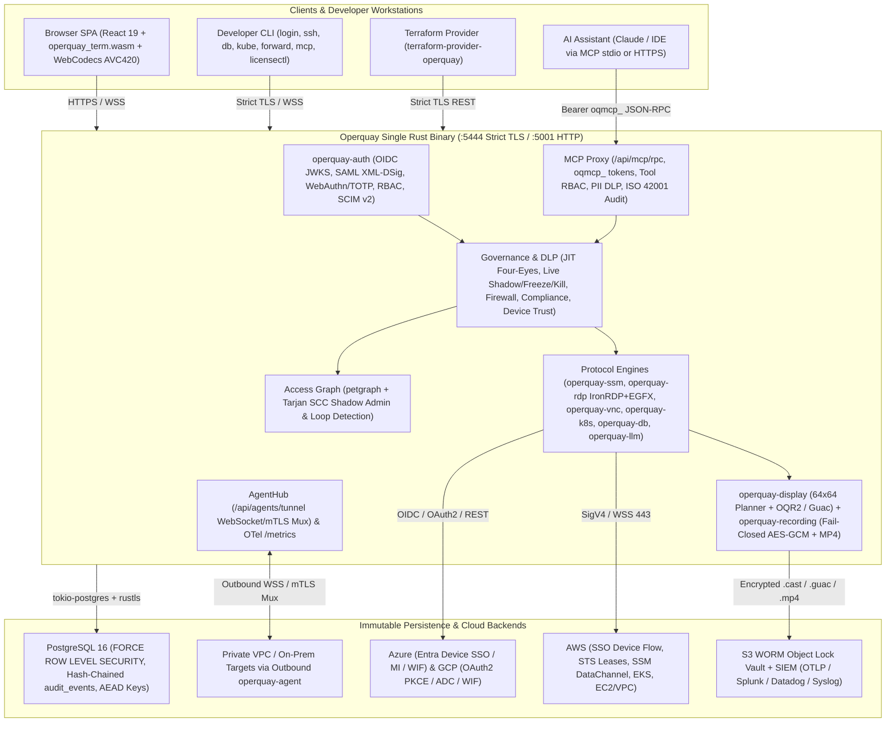
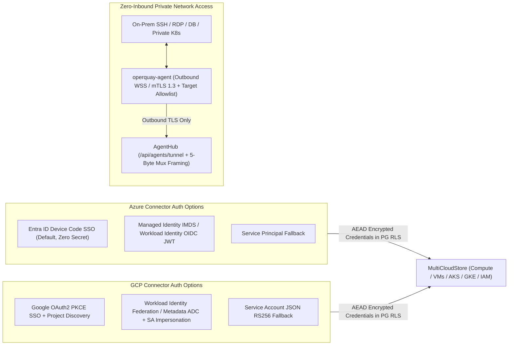

# Operquay-Rust

Enterprise pure-Rust single-binary Zero-Trust Privileged Access Management (`PAM`) & Multi-Cloud Infrastructure Gateway — consolidating interactive SSH/AWS SSM terminals (`operquay_term.wasm`), in-process Windows RDP (`IronRDP` + `WebCodecs AVC420`), VNC, Kubernetes & Teleport, Multi-Database SQL explorer with inline DLP, VPC & unified identity Access Graph, AI/MCP governance proxy, outbound-mTLS hybrid agents, fail-closed encrypted session recording, and OpenTelemetry observability inside **`#![forbid(unsafe_code)]` Rust**.

## System Architecture



## Documentation & Governance

| Document | Purpose |
| :--- | :--- |
| [RULES.md](RULES.md) | Architectural invariants, zero-`unsafe` policy, TLS & SOC 2 / ISO 27001 rules (§3 & §7), and release gates. |
| [AGENTS.md](AGENTS.md) / [CLAUDE.md](CLAUDE.md) | Coding conventions, design-system semantic tokens, and test discipline. |
| [docs/ADR/](docs/ADR/0000-rust-architecture-and-single-binary-roadmap.md) | Architecture Decision Records `0000`–`0012` covering every subsystem, security control, and Mermaid diagram. |
| [tasks.md](tasks.md) | Master milestone delivery log (`M1`–`M12` completed). |

---

## How Every Feature Works (Operator & Architecture Guide)

### 1. Identity, SSO, MFA, RBAC & SCIM 2.0
- **Where in UI**: `Settings -> Administration -> Single Sign On`, `Users`, `Groups & Roles`; personal MFA under `Settings -> Personal -> General`.
- **How it works**:
  - **Local Auth & MFA**: Passwords hash with `bcrypt` / `Argon2id`, enforced by brute-force IP/account lockout and forced initial password rotation. Users enroll **WebAuthn (FIDO2)** passkeys (`/api/auth/mfa/webauthn/*`) or **TOTP** authenticators (`/api/auth/mfa/totp/*`).
  - **Enterprise SSO (`crates/operquay-auth`)**: Supports **OIDC** (PKCE + JWKS `RS256`/`ES256`/`EdDSA` signature verification, checking `iss`, `aud`, `exp`, `nbf`, `nonce`) and **SAML 2.0** (pure-Rust XML-DSig `<ds:Signature>` + Exclusive c14n against pinned X.509 IdP certificates + assertion replay defense).
  - **RBAC & SCIM 2.0**: Default-deny RBAC with scoped grants (`global`, `env`, `aws_account`, `k8s_cluster`), IdP group-to-role mappings, and `/api/scim/v2/*` automated user/group provisioning/deprovisioning.
  - **Edge Hardening**: `__Host-operquay_session` (`Secure; HttpOnly; SameSite=Lax`), explicit `Origin` checks on mutations and WebSocket upgrades, HSTS/CSP headers, and `TRUSTED_PROXIES` CIDR gating.

### 2. Multi-Cloud Connections (AWS, Microsoft Azure & Google Cloud — Secretless SSO First)
- **Where in UI**: Left sidebar -> `Cloud Accounts / + Add` (`CloudConnections.tsx`), or Settings -> `Administration -> AWS Accounts`.



- **AWS (`operquay-aws`, `aws_routes.rs`)**:
  - **IAM Identity Center SSO (Recommended)**: Enter SSO Start URL & Region -> opens AWS verification tab -> polls `/api/aws/sso/poll` -> lists accounts (`/api/aws/sso/accounts`) & roles (`/api/aws/sso/roles` with `portal_sem=2` concurrency cap and `429` `Retry-After` backoff) -> connects user-scoped STS role lease (`/api/aws/sso/connect`).
  - **User Bindings & Role Login**: `/api/aws/user-bindings` & `/api/aws/role-login` persist encrypted STS credentials in PostgreSQL RLS (`user:` isolation prevents cross-user or host-IMDS leakage).
- **Microsoft Azure (`crates/operquay-server/src/multicloud.rs`)**:
  1. **Entra ID SSO (Recommended — Zero Static Secret)**: Uses RFC 8628 OAuth2 Device Authorization (`/api/clouds/azure/sso/start`, `/poll`, `/connect`) with Azure's public client ID (`04b07795-8ddb-461a-bbee-02f9e1bf7b46` or custom App ID). Sign in interactively in the opened Microsoft Entra browser tab, approve the user code, review auto-discovered Azure subscriptions, and click to connect.
  2. **Managed / Workload Identity**: Attach passwordless Azure VM/AKS **Managed Identity (IMDS)** (`managed_identity`) or **Entra Workload Identity** OIDC JWT token file (`workload_identity`) without copy-pasting secrets.
  3. **Service Principal Secret (Fallback)**: Standard `tenant_id` + `client_id` + `client_secret`, sealed with AEAD before PostgreSQL storage.
- **Google Cloud Platform (`crates/operquay-server/src/multicloud.rs`)**:
  1. **Google Cloud SSO (Recommended — Zero Static Key)**: Initiates Google OAuth2 Authorization Code + PKCE (`S256`) (`/api/clouds/gcp/sso/start`, `/callback`, `/status`, `/connect`). After browser consent, Operquay exchanges the code server-side, discovers accessible GCP projects, and lets you connect one-click.
  2. **Workload Identity / ADC**: Uses **GCE/GKE Metadata Server ADC** (`metadata_adc`) or **Workload Identity Federation** STS token exchange (`workload_identity`) with optional Service Account impersonation.
  3. **Service Account JSON (Fallback)**: Signs RS256 OAuth2 JWT assertions server-side using the stored service account private key.

### 3. Interactive SSH / AWS SSM Terminal
- **Where in UI**: Sidebar -> `VMs` tab -> Select EC2 / Hybrid / Cloud VM -> **SSH / Terminal**.
- **How it works**:
  - Opens a browser terminal powered by pure-Rust **`operquay_term.wasm`** (`operquay-term`, VT100/VT220/Xterm with mouse selection, copy, scrollback, and search).
  - `/api/aws/session-ws` connects asynchronously via in-process **`operquay-ssm`** (`AgentMessage` binary frames over `tokio-tungstenite`, `smux` v1 multiplexing — zero `aws` CLI or `session-manager-plugin` binaries).
  - Streams through **bounded** async queues (`RULES.md` §4.1), a fail-closed Asciinema v2 `.cast` `RecordingTee`, the inline `ShellCommandFirewallBuffer`, and a `<= 5s` live lease/JIT `CancellationToken` fence.

### 4. In-Process Windows RDP & VNC Remote Desktop
- **Where in UI**: Sidebar -> `VMs` -> **RDP** or **VNC** (`Settings -> Personal -> Remote Desktop` for quality presets).
- **How it works**:
  - Client calls `POST /api/v1/sessions/launch` (verified against RBAC, AWS/Cloud lease, Recording Policy, and **Device Trust policy**), returning a single-use 60s ticket.
  - WebSocket `/api/v1/ws/rdp?ticket=...` tunnels RDP/VNC inside TCP or AWS SSM `SsmVirtualStream` memory duplexes (zero host loopback ports).
  - **`operquay-rdp` (`ironrdp-*` + `sspi`)**: Full CredSSP/NLA (`HYBRID`/`HYBRID_EX`, `Resumption::disabled()`), `[MS-RDPECLIP]` clipboard, `[MS-RDPEDISP]` dynamic resize, and `[MS-RDPEGFX]` **`AVC420`** (`0x0A H264Frame` -> browser `WebCodecs` `PersistentAvc420Decoder` in `DesktopStage.tsx`) with automatic 64x64 hybrid (`PNG`/`JPEG`/`SolidFill`/`CopyRect`) and Guacamole framing fallback.
  - **`operquay-vnc`**: Pure-Rust RFC 6143 split async client supporting `Raw`, `CopyRect`, `RRE`, `Hextile`, `ZRLE`, `Tight` (+ JPEG/Gradient), `ExtendedDesktopSize`, `VeNCrypt` TLS, and `Apple ARD (Type 30)` — with raw DES blocked in Compliance Mode unless inside an encrypted tunnel.

### 5. Kubernetes & Teleport Workspace
- **Where in UI**: Sidebar -> `K8s` tab (`Settings -> Administration -> Kube clusters`, `Recording policy`).
- **How it works (`operquay-k8s`)**:
  - Connects to AWS EKS clusters via SigV4 presigned STS tokens, uploaded kubeconfigs (strict `exec` binary allowlist), or **Teleport** Auth/Proxy mTLS + gRPC.
  - Displays pods, logs (`/api/k8s/logs`), workloads/metrics, Helm releases, CRDs, and live interactive SPDY/WebSocket `exec`/`attach` wrapped in fail-closed `.cast` recording and `K8sRecordingPolicy` per-cluster/namespace rules.

### 6. Multi-Database SQL Explorer & Inline PII DLP
- **Where in UI**: Sidebar -> `DB` tab (`DatabasesWorkspace.tsx`).
- **How it works (`operquay-db`)**:
  - Polymorphic `DatabaseEngineDriver` dispatches cleanly across **PostgreSQL** (`tokio-postgres` + `rustls`), **ClickHouse**, **DuckDB** (embedded & remote HTTP), **MySQL** (`CLIENT_SSL` + `tokio-rustls`), and **Redis** (`RESP2` + `tokio-rustls`). Compliance Mode blocks plaintext MySQL/Redis connections.
  - Every `/api/db/query` passes through a comment-stripping **Read-Only SQL Guard**, strict identifier validation (`/api/db/mutate`), OpenTelemetry spans, and **`operquay-db::dlp`** inline masking for emails, SSNs, Luhn credit cards, AWS keys, JWTs, and sensitive columns.

### 7. Session Recordings, AI Risk Bookmarks, MP4 Export & S3 WORM
- **Where in UI**: `Settings -> Operations -> Recordings`, plus `Administration -> Recording policy`.
- **How it works (`operquay-recording`)**:
  - Records `.guac` (RDP/VNC) and `.cast` (SSM/K8s) synchronously via fail-closed `RecordingTee`: if `fail_closed = true` and disk write fails (`EACCES`/`ENOSPC`), active sessions abort immediately (`recording_fail_closed_abort`).
  - Encrypts artifacts at rest with AES-256-GCM (OS CSPRNG 96-bit nonces), enforces `fs::canonicalize` containment, supports timeline playback + scrubber (both RDP and Linux `.cast`), exports H.264 MP4/WebM with bounded worker concurrency, generates AI Risk Bookmarks via `operquay-llm`, and supports retention purge (`/api/v1/recordings/purge`) + S3 Object Lock (`WORM`) archival.

### 8. JIT Approvals, Live Session Moderation & Command Firewall
- **Where in UI**: `Settings -> Governance -> Access & DLP`.
- **How it works (`jit.rs`, `governance_routes.rs`)**:
  - **Four-Eyes JIT**: Request temporary elevation via `POST /api/access-requests` -> dispatches HMAC-SHA256 signed webhooks (`/api/governance/webhooks`) to Slack, Teams, PagerDuty, or Jira/ServiceNow -> peer (never requester) approves via UI or signed webhook callback -> active session runs with a 5s expiry fence reaper.
  - **Live Moderation**: Authorized moderators view `/api/sessions/live`, freeze terminal/desktop input (`/api/sessions/{id}/freeze`), or kill sessions immediately (`/api/sessions/{id}/kill`).
  - **Command Firewall (`/api/governance/dlp-policy`)**: Scans shell/K8s commands in real time to block or pause dangerous operations.

### 9. Continuous Compliance, Hash-Chained Audit & SIEM Streaming
- **Where in UI**: `Settings -> Governance -> Compliance` and `Operations -> Audit log`.
- **How it works**:
  - `audit_events` maintains a cryptographic `seq` -> `prev_hash` -> `entry_hash` SHA-256 chain (`REVOKE UPDATE, DELETE` at PostgreSQL role level), verifiable on demand via `GET /api/v1/audit/verify` and streamed to OTLP / Splunk HEC / Datadog / RFC 5424 Syslog (`/api/v1/audit/siem/status`).
  - Compliance Portal manages automated quarterly **Access Review Campaigns** (`/api/compliance/access-reviews`), live **SOC 2 / ISO 27001 Posture** (`/api/compliance/posture`), break-glass alerts, and **Ed25519-signed Evidence Bundles** (`/api/compliance/evidence-bundle` & `/verify`).

### 10. AI Agent & Model Context Protocol (`MCP`) Zero-Trust Proxy (`ISO 42001`)
- **Where in UI**: `Settings -> Governance -> AI & MCP Proxy` (`McpProxyPanel.tsx`), or CLI `operquay mcp`.
- **How it works (`m12_routes.rs`)**:
  - Register AI agents (`/api/mcp/agents`) bound to an accountable human sponsor (`sponsor_user_id`), issuing short-lived `oqmcp_...` tokens stored as SHA-256 hashes.
  - Requests to `POST /api/mcp/rpc` enforce per-tool `allowed_tools` RBAC, sliding rate limits, mandatory JIT approval for `require_jit_tools` (returning JSON-RPC `-32010` + `jit_request_id`), forced `__ai_mcp_agent__` SQL DLP masking, `redact_pii_text_for_mcp` response sanitization, and full prompt/tool audit history (`/api/mcp/invocations`).

### 11. Zero-Inbound Hybrid Reverse-Tunnel Agent (`operquay-agent`)
- **Where in UI**: `Settings -> Administration -> Hybrid Agents` (`HybridAgentsPanel.tsx`).
- **How it works (`crates/operquay-agent`, `AgentHub`)**:
  - Enroll a private-network connector via `POST /api/agents/enroll` -> receive the exact CLI launch command with one-time token -> run `operquay-agent --server wss://<host>/api/agents/tunnel --name <name> --token <token>` inside private VPCs or on-premises networks.
  - Maintains an outbound-only TLS/WebSocket multiplexed tunnel (`AgentHub`) with strict per-agent target CIDR/host:port allowlists (`/api/agents/{id}/dial-check`), giving zero inbound firewall exposure to private SSH, RDP, DB, or K8s targets.

### 12. Unified Access Graph & Blast Radius Analysis
- **Where in UI**: `Settings -> Governance -> Access Graph` (`AccessGraphPanel.tsx`).
- **How it works (`m12_routes.rs::build_tenant_access_graph`)**:
  - Builds a unified directed graph (`petgraph` + `tarjan_scc`) across users, groups, RBAC roles, cloud IAM roles, AI agents, EC2/Azure/GCE compute, K8s clusters, databases, and hybrid hosts.
  - Detects **Shadow Admins**, **Trust Loops** (strongly connected components), **Unused Privileges**, and computes per-principal **Blast Radius** (`/api/access-graph/blast-radius/{principal_id}`).

### 13. Device Trust (MDM / EDR Posture Gate)
- **Where in UI**: `Settings -> Governance -> Device Trust` (`DeviceTrustPanel.tsx`).
- **How it works**:
  - Configures organization posture policy (`GET/PUT /api/device-trust/policy`: disk encryption, EDR running, MDM enrolled, OS minimum version, max attestation age) and ingests workstation attestations from CrowdStrike, Jamf, Intune, or osquery (`POST /api/device-trust/attest`).
  - `POST /api/v1/sessions/launch` automatically evaluates the caller's device posture and blocks non-compliant workstations with HTTP `403`.

### 14. Developer CLI & Terraform / OpenTofu Provider
- **CLI Subcommands (`operquay`)**:
  - `operquay login --server https://... --email ... --password ... --ca-cert <pem>` (saves `0600` strict-TLS credentials)
  - `operquay ssh <instance-id> [--region ... --profile ...]` (interactive SSM shell)
  - `operquay db --connection-id <id> --sql "SELECT ..."` (DLP-redacted read-only SQL)
  - `operquay kube --cluster <name> [--namespace default --pod <pod> --command /bin/sh]`
  - `operquay mcp --server https://... --token oqmcp_... [--ca-cert <pem>]` (bridges IDE/Claude stdio JSON-RPC 2.0 to `/api/mcp/rpc`)
  - `operquay forward --ws-url wss://... --pairing-code <code> --listen 127.0.0.1:15432`
  - `operquay licensectl {keygen | issue | verify}` (Ed25519 offline/heartbeat entitlement keys)
- **Terraform Provider (`terraform-provider-operquay/`)**: Declaratively manages `operquay_role`, `operquay_recording_policy`, `operquay_dlp_policy`, `operquay_mcp_agent`, `operquay_device_trust_policy`, `operquay_cloud_connector`, and `operquay_governance_webhook` over strict TLS.

---

## Workspace Crates (`20` Rust Crates, `#![forbid(unsafe_code)]` + Terraform Go Provider)

| Crate / Module | Responsibility |
| :--- | :--- |
| `operquay-core` | Domain config, RBAC types, goal-based remote desktop presets, error & tenant primitives. |
| `operquay-telemetry` | OpenTelemetry W3C TraceContext propagation (`trace_id`), JSON logging, and OTLP / Prometheus `/metrics`. |
| `operquay-guac` | Guacamole 1.6.0 length-prefixed UTF-8 frame parser/serializer and session state machine. |
| `operquay-display` | `64x64` rolling-hash `CopyRect`/tile planner and dual `OQR2` (including `0x0A H264Frame`) / Guacamole wire encoding. |
| `operquay-rdp` | In-process `ironrdp-*` (`0.3`–`0.13`) enterprise RDP engine (`CredSSP` NLA, `[MS-RDPEGFX]` AVC420, `[MS-RDPECLIP]`, `[MS-RDPEDISP]`, `standard_sec` fallback gated in Compliance Mode). |
| `operquay-vnc` | Clean-room RFC 6143 split async VNC client (`Raw`, `CopyRect`, `RRE`, `Hextile`, `ZRLE`, `Tight` + JPEG/Gradient, `ExtendedDesktopSize`, `VeNCrypt`, `Apple ARD`). |
| `operquay-ssm` | Pure-Rust AWS SSM `AgentMessage` binary DataChannel, `smux` v1 muxing, `SsmVirtualStream`, and `ShellCommandFirewallBuffer`. |
| `operquay-recording` | Fail-closed `.guac`/`.cast` `RecordingTee`, AES-256-GCM encryption at rest, `fs::canonicalize` containment, WORM S3 archival, and pure-Rust H.264 MP4/WebM export. |
| `operquay-term` | Pure-Rust VT100/VT220/Xterm terminal grid, scrollback, text search, selection, and rasterization. |
| `operquay-term-wasm` | `wasm-bindgen` browser terminal engine (`dist/operquay_term.wasm`) powering `Xterm.tsx`. |
| `operquay-auth` | Multi-tenant PG `FORCE ROW LEVEL SECURITY`, `bcrypt`/`Argon2id`, WebAuthn/TOTP MFA, OIDC JWKS, SAML 2.0 XML-DSig/c14n, RBAC, SCIM v2, and 96-bit `OsRng` AEAD. |
| `operquay-aws` | Pure-Rust SigV4 signer (`reqwest`), AWS SSO device flow + 429 retry, PG-persisted leases, EC2 **discovery/fetch**, AMI clone, `SendCommand`/S3 transfer, and `petgraph` VPC topology. |
| `operquay-suggest` | AEAD-encrypted command history, Trie/frecency/MLP predictor, and ErrorKB. |
| `operquay-llm` | Multi-provider LLM SSE gateway (`Bedrock`, `Anthropic`, `OpenAI`, `Gemini`, `Ollama`), PII safety guardrails, and recording AI risk bookmarks. |
| `operquay-k8s` | EKS SigV4 STS token provider, kubeconfig allowlist, Helm parser, SPDY/WS pod `exec`/logs, Teleport mTLS/gRPC, and `K8sRecordingPolicy`. |
| `operquay-db` | Polymorphic `DatabaseEngineDriver` (`Postgres`, `ClickHouse`, `DuckDB`, `MySQL` TLS, `Redis` TLS), SQL read-only guards, and `operquay-db::dlp` PII masking. |
| `operquay-forward` | 5-byte multiplexed TCP/WS forwarder and `operquay` CLI (`login`, `ssh`, `db`, `kube`, `mcp`, `forward`). |
| `operquay-license` | Ed25519 signed `OPQL1.` enterprise entitlement verification + `licensectl`. |
| `operquay-agent` | Standalone outbound-mTLS reverse-tunnel daemon enabling zero-inbound private network access. |
| `operquay-server` | Axum HTTPS/WSS control plane serving REST APIs, `OQR2`/Guac WS, SSM WS, MCP Proxy, AgentHub, Multi-Cloud SSO, JIT Governance, Hash-Chained Audit, and embedded React 19 SPA. |
| `terraform-provider-operquay` | Pure-Go Terraform / OpenTofu provider for declarative RBAC, DLP, Recording Policy, MCP, Device Trust, Multi-Cloud, and Webhook config. |

---

## Architecture Decision Records (`0000`–`0012`)

| ADR | Scope |
| :--- | :--- |
| [ADR-0000](docs/ADR/0000-rust-architecture-and-single-binary-roadmap.md) | Pure-Rust Single-Binary Architecture, 20-Crate Topology & Complete Index |
| [ADR-0001](docs/ADR/0001-reverse-engineered-guacamole-wire-and-display-engine.md) | Reverse-Engineered Guacamole 1.6.0 Wire Protocol & `operquay-display` |
| [ADR-0002](docs/ADR/0002-pure-rust-rdp-engine-without-ironrdp.md) | Server-Side In-Process `IronRDP` Enterprise RDP Engine |
| [ADR-0003](docs/ADR/0003-pure-rust-vnc-engine-design.md) | Clean-Room Pure-Rust VNC Engine (`Raw`–`Tight` + `VeNCrypt` + `Apple ARD`) |
| [ADR-0004](docs/ADR/0004-in-process-ssm-datachannel-and-port-forwarding.md) | In-Process AWS SSM DataChannel, `smux`, SSO Pacing & 5s Live Fences |
| [ADR-0005](docs/ADR/0005-recording-fail-closed-and-in-process-mp4-pipeline.md) | Fail-Closed Recording (`.guac`/`.cast`), Encryption, WORM S3 & In-Process MP4 |
| [ADR-0006](docs/ADR/0006-go-to-rust-full-subsystem-migration-and-single-binary-packaging.md) | Go -> Rust Migration Matrix, Non-Root Container & PG Continuity |
| [ADR-0007](docs/ADR/0007-low-latency-rdp-v2-webcodecs-and-design-system-settings.md) | Low-Latency `OQR2`, `[MS-RDPEGFX]` `AVC420` (`0x0A`), OTel & Design System |
| [ADR-0008](docs/ADR/0008-pure-rust-wasm-terminal-and-complete-go-parity.md) | Pure-Rust WASM Terminal Engine (`operquay_term.wasm`) & Platform Parity |
| [ADR-0009](docs/ADR/0009-object-oriented-multi-database-and-opentelemetry-architecture.md) | Polymorphic Multi-Database Drivers, Mandatory TLS, Inline DLP & OTel |
| [ADR-0010](docs/ADR/0010-soc2-iso27001-security-and-zero-standing-privileges.md) | SOC 2 Type II, ISO/IEC 27001:2022 Security & Zero Standing Privileges |
| [ADR-0011](docs/ADR/0011-jit-access-live-moderation-dlp-and-compliance-portal.md) | Four-Eyes JIT, Live Moderation, Command Firewall & Compliance Portal |
| [ADR-0012](docs/ADR/0012-mcp-proxy-hybrid-agent-multicloud-sso-access-graph-and-device-trust.md) | AI/MCP Proxy, `operquay-agent`, Azure/GCP Secretless SSO, Access Graph, Device Trust & CLI/TF |

---

## Quick Start (Container Stack with Strict Local TLS)

Requires Docker or Podman + `mkcert` certificates under `deploy/certs/` (`operquay-local-cert.pem` & `operquay-local-key.pem`). Runs external **PostgreSQL 16** on `:5454` and the single **`operquay`** non-root container exposing `:5444` (HTTPS/WSS) and `:5001` (HTTP):

```bash
# 1. Start or rebuild deploy-operquay-1 + deploy-postgres-1
env -u DOCKER_DEFAULT_PLATFORM -u PODMAN_DEFAULT_PLATFORM \
  podman compose -f deploy/docker-compose.yml up -d --build operquay

# 2. Verify health over strict TLS using the mkcert root CA (never bypass TLS)
curl -fsS --cacert "$(mkcert -CAROOT)/rootCA.pem" https://localhost:5444/health

# 3. Verify Prometheus telemetry
curl -fsS --cacert "$(mkcert -CAROOT)/rootCA.pem" https://localhost:5444/metrics | head -n 20
```

- **UI URL**: `https://localhost:5444` (default dev bootstrap email: `admin@local` with `$OPERQUAY_ADMIN_PASSWORD`, default `Password@123`; forced password rotation supported in `M9`).
- **Compliance & Security Defaults**: Fail-closed `FORCE ROW LEVEL SECURITY`, hash-chained immutable `audit_events`, `__Host-` `Secure` cookies, CSRF `Origin` enforcement, encrypted recordings, `<= 5s` live lease/JIT fences, mandatory MySQL/Redis TLS, and Zero `unsafe_code`.

## Verification Gates

```bash
# 1. Rust workspace checks (formatting, strict clippy pedantic, all 20 crates)
cargo fmt --all -- --check
cargo clippy --workspace --all-targets -- -D warnings
cargo test --workspace

# 2. Frontend checks (TypeScript, ESLint, Vitest + WASM bundle build)
cd frontend
pnpm run typecheck
pnpm run lint
pnpm test
pnpm run build
ls -la dist/operquay_term.wasm

# 3. Terraform provider checks (Go 1.24)
cd ../terraform-provider-operquay
go vet ./...
go test ./...
go build ./...
```
