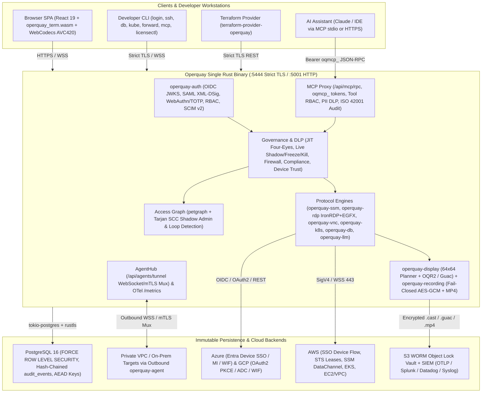

# ADR-Rust 0000: Pure-Rust Single-Binary Architecture & Enterprise Roadmap

## Status

Accepted & Implemented (20-Crate Single-Binary Rust Workspace Live Across Milestones `M1`–`M12`, Paired with Pure-Go `terraform-provider-operquay`)

## Date

2026-11-19 (Updated from 2026-11-16 initial architecture baseline)

## Context

Legacy Operquay operated as a multi-container Go + Node.js + C/C++ stack (`operquay-app`, `guac-lite`, `guacd`, plus optional `converter`) spawning OS subprocesses per session (`aws`, `session-manager-plugin`, `socat`, `tsh`, forked `guacd` child processes, Linux PTYs via `creack/pty`, and fixed container loopback ports `33890–33999`).

### Measured Legacy Baseline (Observed)

| Container / Component | Observed Idle Memory | Configured Mem Limit | Observed Idle PIDs | Observed Docker Image Size | Legacy Runtime Stack |
| :--- | ---: | ---: | ---: | ---: | :--- |
| `operquay-app` | `64.69 MiB` | `1 GiB` | `8` | `931 MB` | Go binary + AWS CLI v2 + SSM plugin + `tsh` + `socat` |
| `guac-lite` | `80.04 MiB` | `256 MiB` | `11` | `245 MB` | Node.js 24 + `guacamole-lite` |
| `guacd` | `24.80 MiB` | `512 MiB` | `1` | `367 MB` | Alpine + `guacd` + FreeRDP + LibVNC + Cairo + Ghostscript |
| **Total Non-DB App Tier** | **`169.53 MiB`** | **`1.75 GiB` reserved** | **`20` idle** | **`1,543 MB`** | 3 separate containers + per-session spawned OS processes |
| `operquay-postgres-1` (kept external) | `66.79 MiB` | `7.748 GiB` host | `8` | `424 MB` | PostgreSQL |

## Hard Architectural Principles

1. **Zero Sidecars & Single Rust Binary**: Consolidate all control-plane APIs, React 19 SPA (`rust-embed`), WASM terminal (`operquay-term-wasm`), AWS SSM DataChannel (`operquay-ssm`), desktop remoting (`operquay-rdp`, `operquay-vnc`, `operquay-display`, `operquay-guac`), multi-DB explorer (`operquay-db`), Kubernetes proxy (`operquay-k8s`), AI guardrails & MCP proxy (`operquay-llm`, `operquay-suggest`), fail-closed recording (`operquay-recording`), licensing (`operquay-license`), and telemetry (`operquay-telemetry`) into one `#![forbid(unsafe_code)]` Rust binary backed by PostgreSQL (`tokio-postgres` + `FORCE ROW LEVEL SECURITY`), complemented by the outbound-only `operquay-agent` daemon and Go `terraform-provider-operquay`.
2. **Pure-Rust In-Process RDP (`ironrdp-*` Server-Side Suite)**: Rather than delegating to `guacd` or keeping partial hand-rolled stubs, `operquay-rdp` runs server-side `ironrdp-*` crates pinned in `Cargo.toml` (`ironrdp-core 0.3`, `ironrdp-cliprdr 0.9`, `ironrdp-displaycontrol 0.10`, `ironrdp-dvc 0.10`, `ironrdp-svc 0.10`, `ironrdp-graphics 0.11`, `ironrdp-pdu 0.11`, `ironrdp-connector 0.12`, `ironrdp-tokio 0.12`, `ironrdp-session 0.13`) directly inside `operquay-server`. Credentials stay server-side in `SecretString` (`ZeroizeOnDrop`) and never reach browser JS/WASM.
3. **Pure-Rust Cloud & TLS Stack**: AWS calls use custom pure-Rust SigV4 signing (`crates/operquay-aws/src/sigv4.rs`) + `reqwest 0.12` + `tokio-tungstenite 0.26` over `rustls` (no `aws` CLI or `session-manager-plugin`); database & cluster clients use `tokio-postgres 0.7`, `tokio-rustls 0.26`, and `reqwest`.
4. **No Mock Sessions in Production**: Runtime SSH/SSM and RDP/VNC paths require real infrastructure targets (`i-*` / `mi-*` / `DirectTcp` / `SsmTunnel`); mock desktop/shell fallbacks are strictly disabled outside unit/integration tests.
5. **Trusted Local TLS & Browser Ergonomics**: Local HTTPS on `:5444` loads CA-trusted `mkcert` certificates mounted into `deploy/docker-compose.yml` (`TLS_CERT_FILE` / `TLS_KEY_FILE`) with a 365-day `rcgen` fallback and explicit `tracing::warn!` TLS handshake error logging. Frontend desktop UI uses `RdpDesktopClient` (`DesktopStage.tsx` + serialized `paintQueue`) and AWS instance **discovery/fetch**.

## Decision & Current 20-Crate Workspace Topology

The workspace in [Cargo.toml](../../Cargo.toml) builds the single `operquay` control-plane binary (`crates/operquay-server/src/main.rs`), the outbound-mTLS `operquay-agent` daemon (`crates/operquay-agent`), and `operquay_term.wasm`, complemented by `terraform-provider-operquay`:

## ADR Index & Architectural Decisions

| ADR | Scope | Current Decision & Status Summary |
| :--- | :--- | :--- |
| [ADR-0001](./0001-reverse-engineered-guacamole-wire-and-display-engine.md) | Guacamole Wire & `operquay-display` | Implemented: `operquay-guac` wire codec + 5-phase `64x64` rolling-hash `copy` planner (`PNG`/`JPEG`/`rect`/`cfill`), dual `OQR2` + Guacamole support via `RdpDesktopClient.tsx`. |
| [ADR-0002](./0002-pure-rust-rdp-engine-without-ironrdp.md) | Pure-Rust `IronRDP` Engine | Revised & Implemented: Server-side `ironrdp-*` (`0.3`–`0.13`) + `sspi` NLA (`HYBRID`/`HYBRID_EX`), `standard_sec` fallback, `SsmLoopbackIgnore` / `TofuPinned` / `StrictCa`, upfront `user:` lease check (`401`), live AWS Windows verified. |
| [ADR-0003](./0003-pure-rust-vnc-engine-design.md) | Pure-Rust VNC Engine | Implemented: Split async RFC 6143 RFB 3.3–3.8 (`Raw`, `CopyRect`, `RRE`, `Hextile`, `ZRLE`, `Tight` + JPEG/Gradient, `Cursor`, `DesktopSize`, `ExtendedDesktopSize`, `VNCAuth` DES gated in Compliance Mode, `VeNCrypt`, `Apple ARD (Type 30)`). |
| [ADR-0004](./0004-in-process-ssm-datachannel-and-port-forwarding.md) | In-Process SSM DataChannel | Implemented: Native `AgentMessage` WS shell + `smux` virtual stream, bounded channels, fail-closed `.cast` tee, `<= 5s` live lease fence, PG RLS SSO/lease persistence, AWS SSO `portal_sem` + 429 retry, and `user:` isolation. |
| [ADR-0005](./0005-recording-fail-closed-and-in-process-mp4-pipeline.md) | Fail-Closed Recording & MP4 | Implemented: Fail-closed desktop `.guac` & SSM/K8s `.cast` tees, AES-256-GCM encryption at rest, `fs::canonicalize` containment, compressed MP4/WebM export, and S3 Object Lock WORM archival. |
| [ADR-0006](./0006-go-to-rust-full-subsystem-migration-and-single-binary-packaging.md) | Full Go -> Rust Migration | Implemented: 20-crate Rust workspace + `terraform-provider-operquay` live with non-root runtime, fail-closed RLS, persistent AWS leases, and real K8s SPDY/WS exec + Teleport mTLS/gRPC. |
| [ADR-0007](./0007-low-latency-rdp-v2-webcodecs-and-design-system-settings.md) | `OQR2`, `AVC420` & OTel | Implemented: `OQR2` binary framing, `[MS-RDPEGFX]` `AVC420` (`0x0A H264Frame` + `PersistentAvc420Decoder`), `DesktopStage.tsx` serialized `paintQueue` + WS error alerts, `TelemetryHub`, and goal-based settings presets. |
| [ADR-0008](./0008-pure-rust-wasm-terminal-and-complete-go-parity.md) | Pure-Rust WASM Terminal & Parity | Implemented: `#![forbid(unsafe_code)]` `operquay-term` + `operquay_term.wasm` + 20-crate parity surface with M9–M12 compliance, persistence & governance controls. |
| [ADR-0009](./0009-object-oriented-multi-database-and-opentelemetry-architecture.md) | Multi-DB Drivers & OTel | Implemented: `DatabaseEngineDriver` (`Postgres`, `ClickHouse`, `DuckDB`, `MySQL`, `Redis`), enforced TLS 1.2+, read-only SQL guards, inline PII DLP masking, and W3C OTel `/metrics`. |
| [ADR-0010](./0010-soc2-iso27001-security-and-zero-standing-privileges.md) | SOC 2, ISO 27001 & ZSP Architecture | Implemented: SAML XML-DSig, OIDC JWKS, WebAuthn/TOTP MFA, `__Host-` + CSRF + HSTS/CSP cookies, `TRUSTED_PROXIES`, fail-closed PG `FORCE RLS`, hash-chained `audit_events`, and ZSP. |
| [ADR-0011](./0011-jit-access-live-moderation-dlp-and-compliance-portal.md) | JIT Access, Moderation, DLP & Compliance Portal | Implemented: Four-eyes JIT approvals + HMAC webhooks + 5s expiry reaper, live shadow/freeze/kill moderation, Command Firewall, DB DLP, AI risk bookmarks, and Ed25519 compliance bundles. |
| [ADR-0012](./0012-mcp-proxy-hybrid-agent-multicloud-sso-access-graph-and-device-trust.md) | MCP Proxy, Hybrid Agent, Multi-Cloud SSO, Access Graph & Device Trust | Implemented: `oqmcp_` ISO 42001 proxy, `operquay-agent` WSS/mTLS tunnel, Azure Entra SSO/MI/WIF + GCP OAuth2 PKCE/ADC/WIF, `petgraph` blast-radius graph, Device Trust MDM gate, CLI & Terraform. |

## Risk Register & Remediated Compliance Controls (`M9`–`M12`)

| Baseline Audit Finding | Severity | Delivered Control (`M9`–`M12`) |
| :--- | :--- | :--- |
| SAML XML-DSig & OIDC JWKS signatures not verified (`crates/operquay-auth/src/sso.rs`) | **Critical (P0) — Closed** | Pure-Rust XML-DSig/Exclusive c14n verification + OIDC JWKS (`RS256`/`ES256`/`EdDSA`) & `iss`/`aud`/`nonce` checks live (**M9**). |
| PostgreSQL RLS fails open on unset `app.tenant_id` (`migrations/0002_full_platform_schema.sql`) | **Critical (P0) — Closed** | Enforced `FORCE ROW LEVEL SECURITY` with `NULLIF(current_setting('app.tenant_id', true), '')` under non-superuser `app_runtime` (**M9**). |
| Cookie `Secure`, CSRF Origin check, `TRUSTED_PROXIES`, HTTP CSP/HSTS, lockout, MFA, CSPRNG GCM nonces | **Critical (P0) — Closed** | Hardened HTTPS middleware, WebAuthn/TOTP MFA, lockout/rotation policy, and 96-bit `OsRng` nonces (**M9**). |
| Plaintext TCP in `MySqlDriver` / `RedisDriver` & ungated RC4/DES legacy protocol fallbacks | **High (P0) — Closed** | Enforced `tokio-rustls` TLS on MySQL/Redis and Compliance-Mode gating for legacy RC4/DES (**M9**). |
| Volatile `HashMap` AWS SSO/leases, unbounded SSM channel, missing `.cast` / 5s fence, mutable `audit_events` | **High (P0/P1) — Closed** | PG-persisted leases, bounded SSM queues + fail-closed `.cast` + 5s `CancellationToken` fence (**M9–M10**); hash-chained append-only `audit_events` + WORM S3 + SIEM (**M10**). |
| Teleport stub, `I_PCM` MP4 sizes, missing ZSP / multi-cloud SSO / AI governance | **Medium (P1) — Closed** | Real K8s SPDY/WS exec & Teleport mTLS/gRPC, compressed MP4/WebM (**M10**); JIT four-eyes + DLP (**M11**); MCP Proxy, `operquay-agent`, Azure/GCP secretless SSO, Access Graph & Device Trust (**M12**). |

## SOC 2 Type II & ISO/IEC 27001:2022 Compliance Alignment

- **Boundary & Architecture Protection (`SOC 2 CC6.1, CC6.6` | `ISO A.8.20, A.8.28`)**: Single memory-safe `#![forbid(unsafe_code)]` Rust binary eliminates multi-container lateral hops, Node/C codec attack surfaces, and unauthenticated host loopback ports.
- **Change & SDLC Governance (`SOC 2 CC8.1` | `ISO A.8.25, A.8.32`)**: All architectural changes are governed by ADRs `0000`–`0012`, enforceable gates in [RULES.md](../../RULES.md), and delivered milestones in [tasks.md](../../tasks.md).

## Verification Gates

1. `cargo fmt --all -- --check && cargo clippy --workspace --all-targets -- -D warnings && cargo test --workspace`
2. `pnpm --dir frontend run typecheck && pnpm --dir frontend run lint && pnpm --dir frontend run test && pnpm --dir frontend run build`
3. Strict TLS check (`curl -fsS https://localhost:5444/health` without `-k`), real AWS EC2 SSM SSH (`i-*`) + IronRDP (`i-*`) validation, and M9–M12 security/compliance gates per [RULES.md](../../RULES.md).
