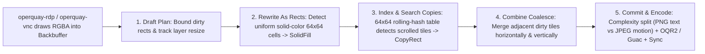

# ADR-Rust 0001: Reverse-Engineered Guacamole 1.6.0 Wire Protocol & Display Engine (`operquay-guac` + `operquay-display`)

## Status

Accepted & Implemented (In-Process `operquay-guac` + `operquay-display` Live Over Dual `OQR2` / `guacamole` WebSocket)

## Date

2026-11-19 (Updated from 2026-11-16 initial baseline)

## Context

To eliminate both `guacd` (`367 MB` Alpine image, `24.80 MiB` idle RAM, `fork()` per connection, C memory-safety surface across Cairo/FreeRDP/LibVNC/libpng/libjpeg/libwebp) and `guac-lite` (`245 MB` Node 24 image, `80.04 MiB` idle RAM) while preserving full compatibility with `.guac` session recordings (`Guacamole.SessionRecording` in `GuacPlayer.tsx`) and offering ultra-low-latency browser remoting, we reverse-engineered the live Alpine Guacamole 1.6.0-r3 binaries (`guacd` and `libguac.so.25.0.0`) and legacy `guacamole-common.js` (`16,261` lines).

On the frontend, the legacy Guacamole client wrapper was refactored and renamed to **`RdpDesktopClient`** ([frontend/src/components/rdp/RdpDesktopClient.tsx](../../frontend/src/components/rdp/RdpDesktopClient.tsx)) wrapping [`DesktopStage.tsx`](../../frontend/src/rust-engines/DesktopStage.tsx), which supports both native `operquay-rdp-v2` (`OQR2` binary framing) and Guacamole instruction framing with serialized canvas mutation ordering (`paintQueue`).

## Reverse-Engineered Findings (Observed in `guacd`, `libguac.so.25.0.0`, and `guacamole-common.js`)

### 1. Guacamole Wire Framing & Protocol Versions

- **Framing Grammar**: Length-prefixed UTF-8 elements separated by commas `,`, terminated by semicolon `;`, with each element encoded as `<decimal_utf8_char_length>.<value>`:
  ```text
  4.size,4.1920,4.1080,2.96;
  ```
- **Observed Version Table (`guac_protocol_version_table @ 0x205e0` in `libguac.so.25.0.0`)**:
  - `VERSION_1_0_0` (`0x010000`)
  - `VERSION_1_1_0` (`0x010100`)
  - `VERSION_1_3_0` (`0x010300`)
  - `VERSION_1_5_0` (`0x010500`)
- **`guacd` Session Startup Lifecycle (Observed in `guacd` dynamic symbols & `.rodata`)**:
  1. Accepts TCP/TLS (`SSL_CTX_new`, `SSL_CTX_use_certificate_chain_file`) on `:4822`.
  2. Reads client `select,<protocol_or_conn_id>;` using `guac_parser_expect`.
  3. Forks child process (`fork`) with Unix socket IPC (`socketpair`, `sendmsg`/`recvmsg`) and loads `libguac-client-<protocol>.so` via `guac_client_load_plugin` (`rdp` or `vnc`).
  4. Server emits `args,<arg1>,<arg2>,...;` listing protocol parameters (88 for RDP, 51 for VNC).
  5. Client responds with handshake instructions (`__guac_handshake_handler_map @ 0x20700`): `size`, `audio`, `video`, `image`, `timezone`, `name`, followed by `connect,<val1>,<val2>,...;`.
  6. Server emits `ready,<connection_id>;` and enters the runtime instruction loop.

### 2. Observed Opcode Surface

#### A. Client-to-Server Handshake Opcodes (`__guac_handshake_handler_map @ 0x20700`)

| Opcode | Payload Purpose | Notes |
| :--- | :--- | :--- |
| `size` | `<width>,<height>[,<dpi>]` | Initial desired display dimensions & DPI |
| `audio` | `<mime1>,<mime2>,...` | Client-supported audio codecs |
| `video` | `<mime1>,...` | Client-supported video streams |
| `image` | `<mime1>,...` | Client-supported image codecs (`image/png`, `image/jpeg`) |
| `timezone` | `<IANA_tz>` | Client timezone forwarded to RDP (`TZ`) |
| `name` | `<human_name>` | Operator display name |

#### B. Runtime Client-to-Server Opcodes (`__guac_instruction_handler_map @ 0x20780`)

All 17 runtime handlers observed in `libguac.so.25.0.0`:

| Opcode | Purpose | Latency / Priority Behavior |
| :--- | :--- | :--- |
| `sync` | `<timestamp_ms>` | Browser frame ACK; drives congestion control (`processing_lag`) |
| `mouse` | `<x>,<y>,<button_mask>` | Pointer movement & button mask |
| `touch` | `<id>,<x>,<y>,<rx>,<ry>,<angle>,<force>` | Multi-touch events |
| `key` | `<keysym>,<pressed>` | X11 keysym press/release (`1` or `0`) |
| `clipboard` | `<stream_idx>,<mimetype>` | Opens outbound clipboard stream (browser -> remote) |
| `size` | `<width>,<height>` | Dynamic desktop resize trigger (`guac_client_display_set_size`) |
| `file` | `<stream_idx>,<mimetype>,<filename>` | Inbound file upload stream |
| `pipe` | `<stream_idx>,<mimetype>,<name>` | Named stream pipe |
| `blob` | `<stream_idx>,<base64_data>` | Base64 chunk on open stream |
| `end` | `<stream_idx>` | Closes open stream |
| `ack` | `<stream_idx>,<msg>,<status_code>` | Flow control acknowledgment (`0x0000` OK, `>= 0x0100` error) |
| `get` | `<obj_idx>,<stream_name>` | Object read request |
| `put` | `<obj_idx>,<stream_idx>,<mimetype>,<name>` | Object write request |
| `audio` | `<stream_idx>,<mimetype>` | Browser microphone input |
| `argv` | `<stream_idx>,<mimetype>,<name>` | Dynamic runtime parameter stream |
| `nop` | *(no args)* | Keep-alive heartbeat |
| `disconnect` | *(no args)* | Clean session tear-down |

#### C. Server-to-Client Opcodes (`guacamole-common.js`)

- **Lifecycle / Control**: `ack`, `error`, `disconnect`, `nop`, `required`, `name`, `msg`, `argv`, `nest`, `sync`.
- **Streams & Objects**: `clipboard`, `file`, `filesystem`, `pipe`, `body`, `blob`, `end`, `undefine`, `audio`, `video`, `img`.
- **Display Drawing & Layers**: `png`, `jpeg`, `img`, `copy`, `transfer`, `cursor`, `size`, `move`, `shade`, `dispose`, `reset`, `set`, `rect`, `cfill`, `cstroke`, `lfill`, `lstroke`, `line`, `arc`, `curve`, `clip`, `pop`, `push`, `close`, `start`, `mouse`, `identity`, `transform`, `distort`.

> **Verified Codec Finding (`webp` absence)**: `guacamole-common.js` defines `"png"` and `"jpeg"` instruction handlers, and legacy Go recording converters only decode PNG/JPEG. Standardizing on `"png"`, `"jpeg"`, `"rect"` + `"cfill"`, and `"copy"` preserves 100% playback compatibility for `.guac` audit recordings.

### 3. Reverse-Engineered `guac_display` 5-Phase Frame Pipeline (`libguac.so.25.0.0`)

Disassembly of `guac_display_end_multiple_frames` (`0xc05c`), `guac_display_plan_rewrite_as_rects` (`0xe0b2`), `guac_display_plan_index_dirty_cells` (`0xe60f`), `0xe48c` (cell hash), `guac_display_plan_combine_vertically` (`0xdf68`), `0xeacf` (complexity analyzer), and `guac_display_worker_thread` (`0xebd4`):



1. **64x64 Cell Grid & Uniform Solid-Color Collapse**: Dirty 64x64 cells with uniform pixel values collapse directly into solid fill instructions (`rect` + `cfill` in Guacamole, `0x04 SolidFill` in `OQR2`).
2. **Scroll / Window-Drag Deduplication**: Open-addressed 64x64 tile rolling hash (`hash = hash * 62 + pixel`, verified for exact pixel equality) detects scrolled/moved regions and emits `copy` / `CopyRect` instructions.
3. **Horizontal & Vertical Coalescing**: Adjacent same-class dirty tiles merge to minimize per-frame header overhead.
4. **Entropy Complexity Check & Lag-Adaptive Quality**:
   - Complexity heuristic: `score = (identical_runs * 256) / max(1, transitions) - 1024`. Scores `>= 0` (crisp UI/text/code) encode as lossless **PNG**; scores `< 0` with `area > 4096` encode as lossy **JPEG**.
   - Adaptive JPEG quality curve: `quality(lag) = 90` if `lag <= 19ms`, else `max(30, 110 - lag)` (bounded by operator settings quality floor).

## Implemented Architecture: `operquay-guac` & `operquay-display`

1. **`crates/operquay-guac`**:
   - `#![forbid(unsafe_code)]` streaming wire parser validating UTF-8 lengths by **Unicode scalar count**, bounded against DoS (`8 MiB` max instruction, `128` max args), typed `ClientInstruction`/`ServerInstruction` enums, and `SyncTracker` sliding congestion pacer.
2. **`crates/operquay-display`**:
   - `#![forbid(unsafe_code)]` protocol-agnostic `DisplaySink` trait, dual `front`/`back` `Vec<u32>` RGBA buffers, `64x64` bitset dirty tracking, `planner.rs` 5-phase encoder using `png` + `jpeg-encoder`, and `oqr2.rs` binary framing emitter (`ADR-0007`).
3. **Browser Canvas Ordering (`DesktopStage.tsx`)**:
   - Wraps decoded bitmap/fill/copy canvas operations inside a serialized asynchronous `paintQueue` promise chain so concurrent `createImageBitmap` promises never overwrite newer tiles out of order over high-throughput links.

## Consequences

- **Positive**: Eliminates `guacd` (`367 MB`) and `guac-lite` (`245 MB`), achieves deterministic memory bounds inside safe Rust, keeps dual wire compatibility (`OQR2` for live sessions + Guacamole `.guac` framing for audit recordings), and maintains exact visual sharpness on UI text via entropy-based PNG/JPEG switching.
- **Trade-off**: Dual wire emission (`OQR2` live binary frames while teeing Guacamole `.guac` frames when recording is active) adds modest serialization work on recorded frames; in return `GuacPlayer.tsx` and historical audit tooling work unmodified.

## SOC 2 Type II & ISO/IEC 27001:2022 Compliance Alignment

- **Memory Safety & Vulnerability Management (`SOC 2 CC6.6, CC7.1` | `ISO A.8.8, A.8.28`)**: Replacing C `libguac`/`libpng`/`libjpeg-turbo`/`Cairo` with `#![forbid(unsafe_code)]` Rust bounds-checked framebuffers and capped (`8 MiB` / `128` arg) instruction parsers eliminates heap overflow and parser RCE classes in the gateway boundary.
- **Audit Recording Integrity (`SOC 2 CC7.2` | `ISO A.8.15, A.8.16`)**: `DisplaySink` outputs route synchronously into `RecordingTee` (`ADR-0005`), ensuring every visual frame rendered to an operator is captured faithfully when fail-closed recording is enabled.

## Verification Gates

1. `cargo test -p operquay-guac` and `cargo test -p operquay-display`: Unicode scalar length parsing, `8 MiB`/`128` arg DoS caps, `64x64` scroll copy detection, PNG/JPEG complexity split, `OQR2` frame roundtrips.
2. `pnpm --dir frontend run test`: `RdpDesktopClient.test.tsx` verifying `OQR2` / Guacamole rendering, serialized `paintQueue` ordering, and explicit WS error banners on premature close.
