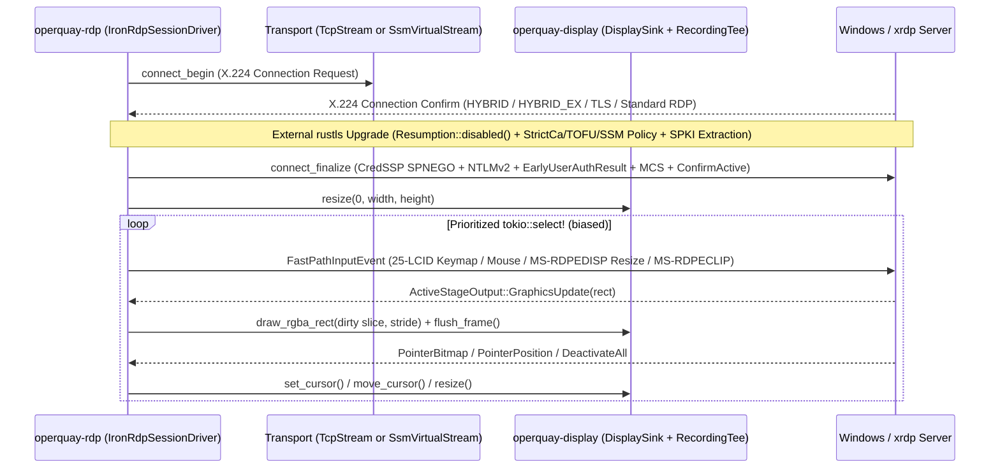

# ADR-Rust 0002: Single-Binary In-Process `IronRDP` Enterprise RDP Engine (`operquay-rdp`, Zero Sidecars)

## Status

Revised & Implemented — Supersedes the `2026-11-16` No-IronRDP Draft (`filename` preserved for link stability; server-side pure-Rust `ironrdp-*` `0.3`–`0.13` stack live and verified against AWS Windows targets)

## Date

2026-11-19 (Updated from 2026-11-18 revision of 2026-11-16 draft)

## Context

Apache Guacamole's legacy RDP stack relied on `libguac-client-rdp.so.0.0.0` (`guacd` C daemon + FreeRDP + OpenSSL) behind `guac-lite` (Node 24). Our `2026-11-16` initial draft explored writing custom NLA/MCS/codec decoders from scratch without `ironrdp*` crates. Audit of that early hand-rolled stub against real Windows Server targets revealed critical production gaps (SPNEGO `TSRequest` ASN.1 negotiation, `HYBRID_EX` `EarlyUserAuthorizationResult`, full MCS/GCC/Licensing state machine, `DeactivateAll` reactivation during Windows logon/resolution changes, and Fast-Path/RLE/EGFX/ClearCodec edge cases).

Evaluating the `ironrdp-*` ecosystem confirmed:
- All core `ironrdp-*` protocol crates are **100% pure Rust** (`zero C/FFI`), compile inside `#![forbid(unsafe_code)]` workspace crates, and run **entirely server-side** inside `operquay-server`.
- Keeping IronRDP strictly server-side requires **zero sidecar containers** (no `guacd`, no `guac-lite`, no `RDCleanPath` proxy), keeps RDP credentials out of browser WASM (`SecretString` / `ZeroizeOnDrop`), preserves fail-closed synchronous `.guac` recording, and reuses `operquay-display` (`OQR2` + Guacamole).

*(Note: The original filename `0002-pure-rust-rdp-engine-without-ironrdp.md` is intentionally kept so existing ADR references do not break; the architectural reversal to server-side `ironrdp-*` crates is already implemented in production.)*

## Implemented `IronRDP` Crate Versions (`Cargo.toml`)

| Crate | Pinned Version | Role in `operquay-rdp` |
| :--- | :--- | :--- |
| `ironrdp-core` | `0.3` | Core encode/decode primitives & cursors |
| `ironrdp-cliprdr` | `0.9` | `[MS-RDPECLIP]` bidirectional UTF-16LE $\leftrightarrow$ UTF-8 clipboard |
| `ironrdp-displaycontrol` | `0.10` | `[MS-RDPEDISP]` dynamic resize (`MonitorLayoutEntry::adjust_display_size`) |
| `ironrdp-dvc` | `0.10` | Dynamic Virtual Channel multiplexing (`DRDYNVC`) |
| `ironrdp-svc` | `0.10` | Static Virtual Channel plumbing |
| `ironrdp-graphics` | `0.11` | `DecodedImage` (`RgbA32`), RLE/codec surface rasterization |
| `ironrdp-pdu` | `0.11` | X.224, MCS, Fast-Path, Capabilities & Licensing PDUs |
| `ironrdp-connector` | `0.12` | `ClientConnector` state machine (`connect_begin`, CredSSP/NLA + `HYBRID_EX`, `connect_finalize`) |
| `ironrdp-tokio` | `0.12` | `TokioFramed` + `new_with_leftover` TLS framing over `AsyncRead + AsyncWrite` |
| `ironrdp-session` | `0.13` | `ActiveStage` runtime loop (`GraphicsUpdate`, `DeactivateAll`, `PointerBitmap`/`Position`) |

## Decision & Implemented Architecture (`crates/operquay-rdp`)

### Key Subsystems

1. **Transport Abstraction (`AsyncRead + AsyncWrite + Unpin + Send`)**:
   - Directly wraps either `tokio::net::TcpStream` (`DirectTcp`) or `operquay_ssm::SsmVirtualStream` (`SsmTunnel`) via `TokioFramed::new(stream)` — zero loopback ports or `socat`.
   - Mock RDP desktop fallback sessions are strictly disabled (`ws.rs:356`, `lib.rs:573`); `/api/aws/rdp/start` validates `user:` AWS role leases upfront (`401` on expired/disconnected role in `platform_routes.rs`) and issues single-use `60s` tickets (`TicketStore`).
2. **TLS & Certificate Pinning (`crates/operquay-rdp/src/tls.rs`)**:
   - Uses `tokio-rustls` + `rustls` (`ring` crypto provider) with `Resumption::disabled()` (required by `[MS-CSSP]` CredSSP channel binding), enforcing `StrictCa`, `TofuPinned` SHA-256 host pinning (`host_cert_pins`), or `SsmLoopbackIgnore` (restricted strictly to inside an already-authenticated SSM tunnel).
   - Preserves pre-TLS buffered bytes via `TokioFramed::new_with_leftover(tls_stream, leftover)`.
3. **Standard RDP Security Fallback (`crates/operquay-rdp/src/standard_sec.rs`)**:
   - Supports legacy servers requiring Classic/Standard RDP security (e.g., certain `xrdp` / legacy Windows configs) using X.509 RSA chain extraction/synthesis (`standard_sec.rs:126-510`) and Standard RDP RC4 security stream.
   - **Compliance Hardening Mandate (Tracked in M9)**: In SOC 2 / ISO 27001 Compliance/FIPS Mode, Classic Standard RDP RC4 fallback MUST be blocked by default unless explicitly allowlisted per host inside an encrypted SSM tunnel and audited (`RULES.md` §3.3.2).
4. **Input, 25-LCID Keymaps, Resize & Clipboard (`keymap.rs`, `clipboard.rs`, `live_client.rs`)**:
   - Reverse-engineered 25 Windows LCID keyboard layouts + dead-key & Unicode Fast-Path fallback (`[0x0000..0xFFFF]` UTF-16).
   - `[MS-RDPEDISP]` dynamic resize strictly clamped to `[200, 8192]` with even pixel width (`width &= !1`).
   - Hardware pointer separation (`enable_server_pointer: true, pointer_software_rendering: false`) for zero-RTT browser overlay cursors.
   - Object-oriented `OperquayCliprdrBackend` (`clipboard.rs`) with `CF_UNICODETEXT` UTF-16LE $\leftrightarrow$ UTF-8 normalization; RDP drive redirection (`RDPDR`) defaults to **disabled** (`enable_drive_redirection = false`).

## Consequences

- **Positive**: Live end-to-end AWS Windows (`i-0645b63c31805537d`) CredSSP/NLA + `StandardRdpSecurityStream` + `OQR2` canvas rendering works cleanly in one Rust process with zero sidecars and server-only credentials.
- **Negative / Risk Managed**: Depending on `ironrdp-*` crates means tracking upstream `0.x` semver releases and carefully gating legacy `standard_sec` RC4 mode in regulated deployments (tracked in **M9**).

## SOC 2 Type II & ISO/IEC 27001:2022 Compliance Alignment

- **Credential Protection & Encryption (`SOC 2 CC6.1, CC6.6, CC6.7` | `ISO A.8.5, A.8.24`)**: Server-side CredSSP keeps passwords/NTLM hashes inside zeroized `SecretString` memory (`ZeroizeOnDrop`) using `60s` single-use tickets; direct connections enforce `StrictCa` or `TofuPinned` SHA-256 pinning; `RDPDR` drive redirection is disabled by default (`ISO A.8.12` DLP).
- **Mandatory Audit & Recording (`SOC 2 CC7.2` | `ISO A.8.15, A.8.16`)**: Desktop sessions run inside fail-closed `.guac` recording (`ws.rs`), validate user AWS role leases upfront (`401` on `legacy_start_rdp`), and record lifecycle audit events with W3C `trace_id`. *(RC4 gating, live 5s lease cancellation in-session, and encrypted recording storage are tracked in M9–M10.)*

## Verification Gates

1. `cargo test -p operquay-rdp` and `cargo test -p operquay-server`: 25-LCID keymap, `[MS-RDPEDISP]` resize clamping, `Resumption::disabled()` TOFU pinning, UTF-16LE clipboard normalization, `401` missing-role rejection, and live loopback + WebSocket `OQR2` frame delivery.
2. Live Target Verification: Verified real AWS SSM tunnel RDP (`StandardRdpSecurityStream` + `GraphicsUpdate` + `OQR2`) against AWS Windows EC2 (`i-0645b63c31805537d`); M9 adds compliance-mode RC4 block negative tests and live in-session lease revocation tests.
