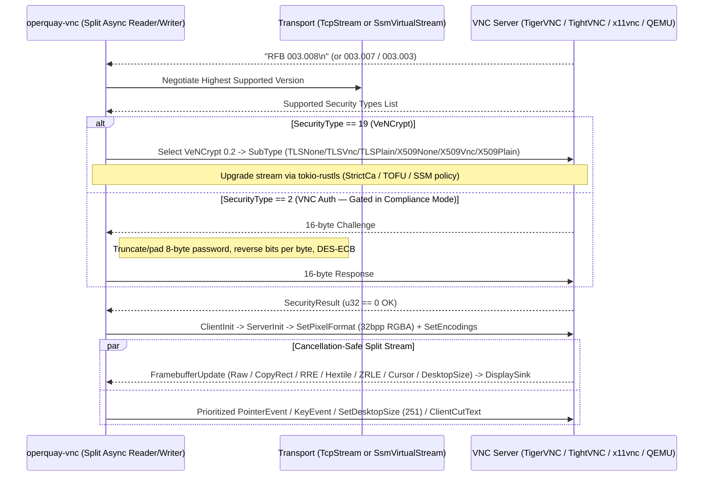

# ADR-Rust 0003: Clean-Room Pure-Rust VNC Engine (`operquay-vnc`) & First-Class Desktop Parity

## Status

Accepted & Implemented (RFC 6143 Split Async Client Live for `Raw`, `CopyRect`, `RRE`, `Hextile`, `ZRLE`, `Tight` + JPEG/Gradient/Palette, `Cursor`, `DesktopSize`, `ExtendedDesktopSize (-308)`, `VNCAuth`, `VeNCrypt`, and `Apple ARD (Type 30)`; Unencrypted DES Gated in Compliance Mode)

## Date

2026-11-19 (Updated from 2026-11-16 initial baseline)

## Context

Inspection of Apache Guacamole 1.6.0-r3 (`libguac-client-vnc.so.0.0.0`, `85,480 B` ELF64) showed 51 VNC client arguments (`GUAC_VNC_CLIENT_ARGS`), dynamic resizing, multi-charset clipboard support, and hardware cursors—capabilities omitted from legacy Go Operquay (which hardcoded RDP `3389`). Rather than retaining `guacd` or C `libvncclient` (historically prone to RRE/ZRLE/Tight heap overflows), Operquay implements a pure-Rust `#![forbid(unsafe_code)]` async RFB client (`crates/operquay-vnc`) plugged into the shared `DesktopEngine` / `DisplaySink` / `SsmVirtualStream` abstractions and rendered in the browser via **`RdpDesktopClient.tsx`** (`DesktopStage.tsx`).

## Decision & Implemented Architecture (`crates/operquay-vnc`)

### Implemented vs Planned Capability Matrix

| Capability | Current Status in `crates/operquay-vnc` | Notes |
| :--- | :--- | :--- |
| **Cancellation-Safe Split I/O** (`live_client.rs`) | **Implemented** | Splits `AsyncRead` / `AsyncWrite` (`tokio::io::split`) across dedicated reader/writer tasks so interactive input never cancels mid-rectangle RFB reads. |
| **RFB 3.3 / 3.7 / 3.8 + `VNCAuth` DES + `VeNCrypt` TLS** (`auth.rs`, `rfb.rs`) | **Implemented** | Supports standard VNCAuth (with RFC 6143 LSB bit-reversal) and VeNCrypt `0.2` TLS/X.509/Plain subtypes via `rustls`. |
| **Core Encodings** (`rfb.rs`) | **Implemented** | `Raw (0)`, `CopyRect (1)`, `RRE (2)`, `Hextile (5)`, stateful connection-scoped zlib `ZRLE (16)`, `Cursor (-239)` bitmask alpha, `DesktopSize (-223)` & `SetDesktopSize (0xfb)`, `ServerCutText`. |
| **Shared Desktop & Recording Pipeline** | **Implemented** | Consumes `TcpStream` or `SsmVirtualStream`, emits via `DisplaySink` to `OQR2` / Guacamole & `RecordingTee` (`fail_closed`), unified ticket flow (`protocol: "rdp" \| "vnc"`). |
| **Tier-2 Encodings & Auth** (`rfb.rs`, `auth.rs`) | **Implemented (M10)** | `Tight (7)` + 4 persistent zlib streams (Fill, Copy, 1bpp/8bpp Palette, Gradient, JPEG), `ExtendedDesktopSize (-308)`, and `Apple ARD (Type 30)` DH + MD5 + AES-128-ECB for macOS targets. |

## Consequences

- **Positive**: Linux GUI desktops (TigerVNC/x11vnc) and VM/macOS consoles run natively in safe Rust with zero C `libvncclient` memory risks, sharing `OQR2`, `.guac` recording, RBAC, and SSM tunneling with RDP.
- **Compliance Trade-off**: Classic `VNCAuth` (8-char DES challenge-response without transport TLS) is cryptographically weak if used over plaintext TCP. Under SOC 2 / ISO 27001 rules (**M9, Implemented**), unencrypted `VNCAuth` without an enclosing encrypted SSM tunnel or `VeNCrypt` TLS is blocked in Compliance Mode.

## SOC 2 Type II & ISO/IEC 27001:2022 Compliance Alignment

- **Transport & Legacy Crypto Controls (`SOC 2 CC6.6, CC6.7` | `ISO A.8.24`)**: Direct VNC targets must negotiate `VeNCrypt` TLS (`TLSPlain`/`X509Plain`/`TLSVnc`/`X509Vnc`) with `StrictCa` or `TofuPinned`; raw DES `VNCAuth` over plaintext TCP is blocked in Compliance Mode (`RULES.md` §3.3.2) and only permitted inside authenticated AWS SSM / mTLS tunnels.
- **Memory Safety & Session Audit (`SOC 2 CC6.1, CC7.1, CC7.2` | `ISO A.8.15, A.8.28`)**: Bounds-checked `#![forbid(unsafe_code)]` RFB decoding prevents integer/buffer overflows on malformed `ZRLE`/`Hextile`/`RRE`/`Tight` rectangles; VNC sessions reuse `TicketStore`, fail-closed `.guac` recording, and hash-chained `audit_events`.

## Verification Gates

1. `cargo test -p operquay-vnc`: RFB 3.8 negotiation, DES bit-reversal vector, `RRE`, `Hextile`, stateful `ZRLE`, `Tight` (Fill/Copy/Palette/Gradient/JPEG), `ExtendedDesktopSize (-308)`, `Apple ARD (30)`, `ServerCutText`, `SetDesktopSize`, and loopback `LiveVnc` test over split async tasks.
2. **M9/M10 Gates (Implemented)**: Compliance-mode gate rejecting non-TLS raw `VNCAuth` outside SSM tunnels, alongside Tier-2 `Tight`, `ExtendedDesktopSize`, and `Apple ARD` unit tests.
