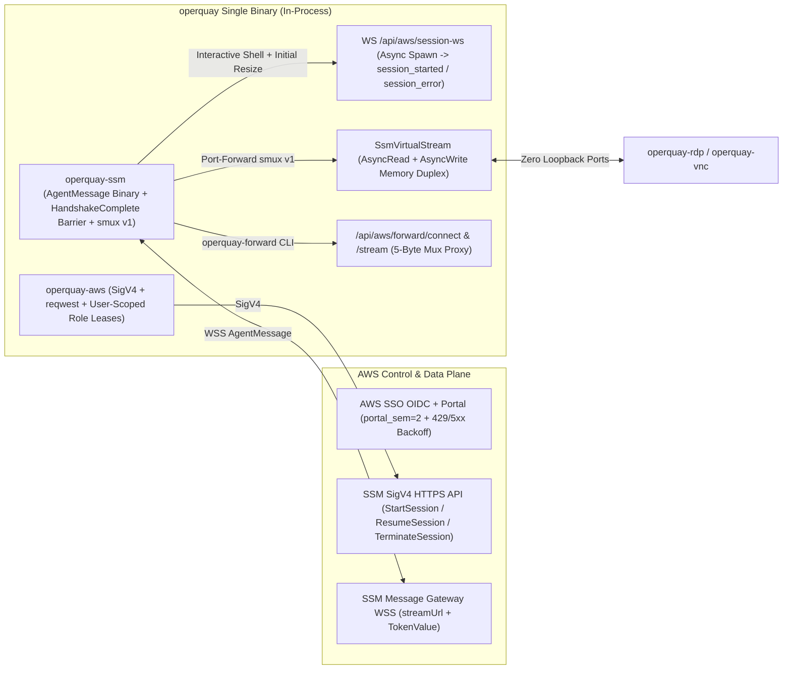

# ADR-Rust 0004: In-Process AWS SSM DataChannel (`operquay-ssm`), Async Session Multiplexing & SSO Pacing

## Status

Accepted & Implemented (Pure-Rust SSM DataChannel, `smux` v1, Async SSH Connect, AWS SSO 429 Retry, Bounded Channels, Fail-Closed `.cast` Recording, `<= 5s` Live Lease Fence & PG RLS Persistence Live)

## Date

2026-11-19 (Updated from 2026-11-16 initial baseline)

## Context

In the legacy Go architecture, interactive SSM shells, SSM-tunneled RDP, and CLI port-forwarding spawned external processes (`aws ssm start-session`, `session-manager-plugin`, `socat`, Linux PTYs via `creack/pty`, and container TCP listeners `33890–33999`), adding image size (`931 MB`), per-session RSS/startup latency, process-reaping complexity, and delayed lease revocation.

During live production testing against real multi-account AWS SSO (`13 accounts`) and EC2 targets (`i-04aef357f2ddf0629` Linux in `ap-south-1`, `i-0645b63c31805537d` Windows), we also uncovered and resolved three operational failure modes:
1. Unpaced bursts of AWS SSO `ListAccountRoles` calls caused transient failures that rendered `"No roles available"` in the UI with no retry affordance.
2. Synchronous `connect_live_shell` blocked `/api/aws/session-ws` loops and emitted `session_started` before SSM connection succeeded, leaving tabs stuck blank on IAM `AccessDeniedException`, while missing initial terminal resize (`cols`/`rows`) and skipping user-scoped (`user_id`) role validation.
3. Container AWS discovery wording previously called EC2 enumeration "scanning" instead of **discovery/fetch**.

## Decision & Implemented Architecture (`crates/operquay-ssm` + `crates/operquay-aws` + `aws_routes.rs`)

### Key Implemented Mechanisms

1. **Pure-Rust AWS Control Plane & Discovery/Fetch (`crates/operquay-aws`)**:
   - Replaces AWS CLI and heavy generated SDKs with pure-Rust SigV4 request signing (`crates/operquay-aws/src/sigv4.rs`) over `reqwest 0.12` (`rustls`).
   - Refactors EC2 enumeration naming cleanly from "scan" to **discovery/fetch** (`discovery.rs`, UI/routes).
   - **SSO Concurrency Pacing & Retry (`crates/operquay-aws/src/sso.rs`, `CloudConnections.tsx`)**: Bounds AWS SSO portal API concurrency via `portal_sem` (`2` permits), retries `429`/`5xx`/transport failures up to 5 attempts honoring `Retry-After` + exponential backoff (`portal_get_json`), caches account names for `"{acct_name} · {role_name}"` role labels, and surfaces retryable role-fetch errors in `CloudConnections.tsx` instead of falsely displaying `"No roles available"`.
   - **Strict User-Scoped Lease Lookup (`aws_routes.rs:1765-1775`)**: `user:` AWS profile prefixes validate strictly against `(tenant_id, user_id, lease_id)` with zero cross-user or ambient IMDS fallback (`AwsAccessMode::User`).
2. **In-Process `AgentMessage` DataChannel (`crates/operquay-ssm/src/live.rs`)**:
   - Speaks AWS `AgentMessage` binary WebSocket frames over `tokio-tungstenite` (`OpenDataChannelInput`, SHA-256 `PayloadDigest`, `SequenceNumber` ACKs, `PayloadType::Output`/`Size`/`HandshakeRequest`/`HandshakeResponse`/`HandshakeComplete`).
   - **Port-Forwarding Reliability**: Enforces the `HandshakeComplete` (`PayloadType = 7`) barrier (with fast synthetic-peer fallback for unit tests) and `smux` v1 (`ver=1`, `SYN/FIN/PSH/NOP`) framing for `amazon-ssm-agent >= 3.0.196.0`, bridging directly into `SsmVirtualStream` with zero loopback TCP ports or OS PTYs.
   - **No-Mock Production Mode**: `/ws` and `/api/aws/session-ws` reject mock shells and require live `i-*` / `mi-*` instance IDs and valid AWS credentials (`lib.rs:1654`, `aws_routes.rs:1745`).
3. **Non-Blocking Async SSH Connect (`crates/operquay-server/src/aws_routes.rs:1640-1846`)**:
   - `start_session` spawns `connect_live_shell` asynchronously so concurrent WS tabs/heartbeats never stall.
   - `session_started` is emitted **only after** SSM DataChannel connects; initial `cols`/`rows` resize is pushed immediately (`chan.send_resize(cols, rows)`).
   - Cancelled or closed pending tabs automatically close the channel and call `ssm:TerminateSession`.
   - Failures emit sanitized `session_error` events surfaced by frontend `ws.ts` + `Xterm.tsx` even on pre-open WebSocket failures.
4. **`operquay-forward` 5-Byte Mux Protocol (`crates/operquay-forward`)**:
   - Preserves `[kind: u8, stream_id: u32_be, payload...]` (`StreamOpen=1`, `StreamData=2`, `StreamClose=3`, `StreamHalfClose=4`) over `/api/aws/forward/connect` and `/stream`.

## Hardening & Persistence Completed in M9–M10

All four runtime hardening items identified in the initial SSM audit are now implemented:
1. **Bounded Channels (`RULES.md` §4.1)**: `aws_routes.rs` replaces `unbounded_channel` with bounded input/resize queues and backpressure/coalesced resize handling (**M9, Implemented**).
2. **Fail-Closed `.cast` Recording on SSM Shells (`RULES.md` §3.5)**: `/api/aws/session-ws` wraps SSM shell I/O in fail-closed Asciinema v2 `.cast` `RecordingTee` (`EACCES`/`ENOSPC` aborts session; **M9, Implemented**).
3. **Live In-Session `<= 5s` Lease Fence Cancellation**: Every active SSM/RDP/VNC/K8s task subscribes to a shared `CancellationToken` watcher polling persisted lease/JIT fences every `<= 5s` so role disconnect, JIT expiry, or SCIM deprovisioning terminates active streams immediately (**M9/M11, Implemented**).
4. **Persistent AWS SSO Flows & Role Leases (`M10, Implemented`)**: AWS SSO provider sessions, encrypted tokens, role leases, discovery inventory, and clone records persist in PostgreSQL with Row-Level Security (`migrations/`), surviving restarts and supporting multi-replica deployments.

## Consequences

- **Positive**: Removes AWS CLI, `session-manager-plugin`, `socat`, `creack/pty`, and host loopback forwarding ports; eliminates SSM startup UI freezes and SSO role-fetch `429` drops.
- **Trade-off**: Maintaining custom pure-Rust SigV4 + `AgentMessage` + `smux` requires strict regression tests whenever AWS SSM agent protocol minor flags evolve.

## SOC 2 Type II & ISO/IEC 27001:2022 Compliance Alignment

- **Access Isolation & Zero-Trust Tunneling (`SOC 2 CC6.1, CC6.6` | `ISO A.8.2, A.8.20, A.8.24`)**: Short-lived user STS credentials never leak into subprocess environments or host IMDS fallbacks; virtual RDP/VNC tunnels stay inside encrypted Tokio memory duplexes (`TLS 1.2+` WSS) with zero exposed host loopback listeners.
- **Monitoring & Session Termination (`SOC 2 CC6.2, CC6.3, CC7.2` | `ISO A.5.18, A.8.15, A.8.16`)**: Upfront lease checks reject unauthorized targets cleanly (`session_error` / `401`), and every running SSM/desktop task binds to fail-closed `.cast`/`.guac` recording and `<= 5s` database lease revocation.

## Verification Gates

1. `cargo test -p operquay-aws` (incl. `retries_sso_list_account_roles_on_429_throttling`) and `cargo test -p operquay-ssm`.
2. Strict-TLS deployment checks verifying `user:missing` SSM `start_session` returning `session_error`, bounded queues, fail-closed `.cast` negative tests, and `< 5s` live lease/JIT fence cancellation.
