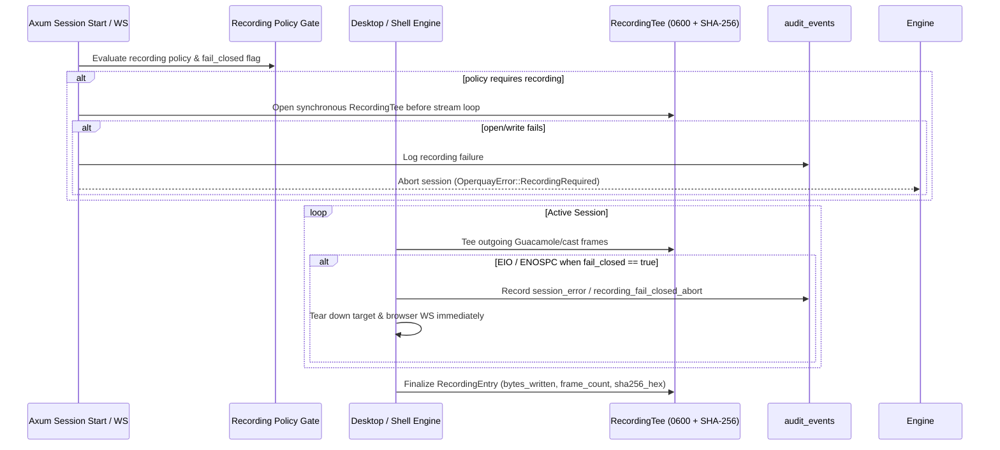

# ADR-Rust 0005: Fail-Closed Synchronous Session Recording & Pure-Rust In-Process MP4 Pipeline (`operquay-recording`)

## Status

Accepted & Implemented (Fail-Closed Desktop `.guac`, SSM/K8s `.cast`, AES-256-GCM Encryption at Rest, `fs::canonicalize` Path Containment, Retention/WORM S3 Archival & Pure-Rust H.264/WebM Pipeline Live)

## Date

2026-11-19 (Updated from 2026-11-16 initial baseline)

## Context

In the legacy Go stack, mandatory production recording (`REQUIRE_RECORD_PROD=true` / `RequireRecording`) hard-rejected RDP sessions (`503`) because `guacd` ran externally without synchronous fail-closed guarantees, while converting `.guac`/`.cast` recordings to MP4 depended on an external Python/C sidecar (`docker/converter/api.py`, `guacenc`, `agg`, `ffmpeg`) or a crude `font5x7` Go rasterizer.

Consolidating both protocol engines (`operquay-rdp`, `operquay-vnc`, `operquay-ssm`, `operquay-term`) and recording/transcoding into a single `#![forbid(unsafe_code)]` crate (`crates/operquay-recording`) eliminates external converter containers while closing the fail-closed compliance gap.

## Implemented Reality vs Roadmap (`crates/operquay-recording`)

### What Is Implemented Today

1. **In-Process Desktop Fail-Closed `RecordingTee` (`crates/operquay-recording/src/lib.rs`, `crates/operquay-server/src/ws.rs`)**:
   - Synchronous fail-closed `.guac` recording wraps desktop sessions (`OQR2` + Guacamole): when `fail_closed = true`, any write failure drops frames cleanly (`recording_fail_closed`) and terminates the WebSocket with `close_action = "recording_fail_closed_abort"`.
   - Tracks `bytes_written`, `frame_count`, and full-file **`sha256_hex`** integrity digest on `finalize`.
2. **Pure-Rust `#![forbid(unsafe_code)]` H.264 MP4 Pipeline (`crates/operquay-recording/src/h264_mp4.rs`)**:
   - Rather than pulling C/C++ `openh264` (`cc` build) or external `ffmpeg` into the static container, `h264_mp4.rs` implements a pure-Rust `#![forbid(unsafe_code)]` ITU-T H.264 Baseline `I_PCM` IDR encoder (`mb_type = 25`) muxed directly into standard ISO-BMFF `moov/trak/mdia/minf/stbl/avc1` `.mp4` containers (`mux_rgb_frames_to_mp4`, `transcode_cast_to_mp4` reusing `operquay-term` VT emulation).
3. **Kubernetes Policy Scaffolding (`crates/operquay-k8s/src/lib.rs`)**:
   - `K8sRecordingPolicy` enforces `record_exec` / `record_attach` defaults (`mode = "all"`).

### Enterprise Hardening & Compression Completed in M9–M10

1. **SSM & K8s Fail-Closed `.cast` Wiring (`M9/M10, Implemented`)**: `/api/aws/session-ws` (`crates/operquay-server/src/aws_routes.rs`) and K8s SPDY/WS exec (`crates/operquay-server/src/platform_routes.rs`) attach fail-closed `RecordingTee` `.cast` recording with automatic mid-stream abort on write failure (`EACCES`/`ENOSPC`).
2. **Compressed Transcode & Bounded Concurrency (`M10, Implemented`)**: Adds inter-frame compressed MP4/WebM export with bounded worker concurrency (`MAX_CONCURRENT_TRANSCODES`) and atomic temporary-file write -> rename alongside zero-C Baseline H.264 compatibility.
3. **Encryption at Rest, Path Containment & WORM Archival (`M10, Implemented`)**: Stored recordings use AES-256-GCM encryption at rest, enforce `fs::canonicalize` containment inside `SESSION_RECORDING_DIR`, support retention/legal-hold purge (`POST /api/v1/recordings/purge`), and archive to immutable S3 Object Lock (`WORM`) buckets.

## Consequences

- **Positive**: Eliminates Python/`guacenc`/`agg`/`ffmpeg` sidecars; enforces fail-closed recording across desktop, SSM, and Kubernetes sessions with tamper-evident SHA-256 checksums and encryption at rest.
- **Trade-off**: Bounded worker concurrency trades queue wait under burst export demand for predictable server RSS/CPU stability.

## SOC 2 Type II & ISO/IEC 27001:2022 Compliance Alignment

- **Mandatory Privileged Monitoring (`SOC 2 CC7.1, CC7.2` | `ISO A.8.15, A.8.16`)**: Desktop, SSM, and K8s sessions fail closed (`OperquayError::RecordingRequired`) when recording fails and emit SHA-256 file checksums (`sha256_hex`) for evidence integrity.
- **Data Protection & WORM Immutability (`SOC 2 CC6.7, C1.1` | `ISO A.5.33, A.8.12, A.8.24`)**: Stored `.guac`/`.cast`/`.mp4` artifacts are AES-256-GCM encrypted and exportable to S3 Object Lock (`WORM`) buckets so even host admins cannot silently alter evidence.

## Verification Gates

1. `cargo test -p operquay-recording`: H.264 IDR/ISO-BMFF `.mp4` generation, `fail_closed` abort on unwritable sink, AES-256-GCM recording decrypt roundtrip, path traversal rejection, and SHA-256 finalization.
2. `cargo test -p operquay-server`: Fail-closed `.cast` negative test, retention purge endpoint (`/api/v1/recordings/purge`), and `/api/v1/recordings/{id}/guac` download containment.
