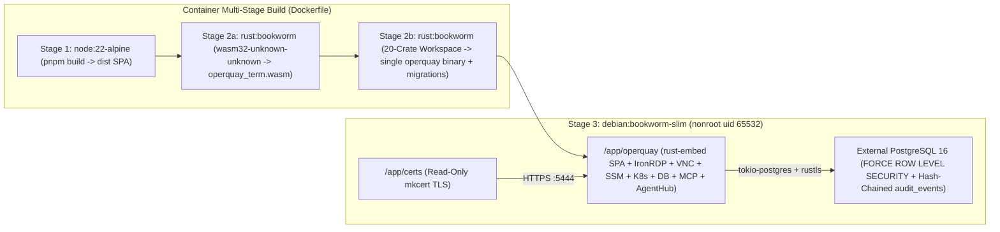

# ADR-Rust 0006: Full Go -> Rust Subsystem Migration Matrix, Database Continuity & Single-Binary Packaging

## Status

Accepted & Complete (20-Crate Rust Workspace Live in Non-Root Container + `operquay-agent` + `terraform-provider-operquay`; M9–M12 Hardening, Persistence, ZSP & GTM Complete)

## Date

2026-11-19 (Updated from 2026-11-16 initial baseline)

## Context

Consolidating Go (`operquay-app`), Node 24 (`guac-lite`), C (`guacd`), and Python (`converter`) into a single `#![forbid(unsafe_code)]` Rust binary preserves PostgreSQL schema continuity (`migrations/0001_remote_desktop_settings.sql`, `migrations/0002_full_platform_schema.sql`) and React 19 SPA UX while cutting deployment footprint from 3 app containers (`1,543 MB`) to 1 container (`operquay`) + external PostgreSQL (`deploy/docker-compose.yml`).

## Implemented Go -> Rust Subsystem Migration Matrix

Exact mapping reflecting the **actual crates and libraries** implemented in `operquay-rust`:

| Legacy Subsystem / ADR | Replaced Go / Sidecar Deps | Implemented Rust Crate(s) & Libraries | Reality & Remaining Gaps (Audited) |
| :--- | :--- | :--- | :--- |
| **Tenant Isolation** (`ADR 0001`) | Go host extractor + `pgx` TX | `operquay-auth::crypto::extract_tenant_id` + `operquay-auth::pg` + `operquay-server::stores` (`tokio-postgres`) | **Implemented (`M9`)**: Enforces `TRUSTED_PROXIES` CIDR allowlist before trusting forwarded/tenant headers and fail-closed `FORCE ROW LEVEL SECURITY` (`NULLIF(...)`). |
| **Auth / SSO / RBAC / SCIM** (`ADR 0002/0019`) | Go `bcrypt`, `go-oidc/v3`, `crewjam/saml`, `pgx` | `operquay-auth` (`bcrypt`, `argon2`, `roxmltree`, `quick-xml`, `aes-gcm`, `hmac`, `sha2`) + `auth_routes.rs` | **Implemented (`M9`)**: Verifies SAML XML-DSig/c14n & OIDC JWKS signatures, WebAuthn/TOTP MFA, lockout/password policy, `__Host-` `Secure`+CSRF cookies, HSTS/CSP, and 96-bit `OsRng` AEAD nonces. |
| **AWS Control Plane & Discovery** (`ADR 0003`) | `aws-sdk-go-v2` + `aws` CLI | `operquay-aws` (pure-Rust `sigv4.rs` + `reqwest 0.12`) + `aws_routes.rs` | **Implemented (`M10`)**: SSO device auth + `portal_sem=2` / 429 retry, user-scoped `user:` leases, EC2 **discovery/fetch**, and PostgreSQL RLS persistence across restarts. |
| **SSM Interactive Shell & Port-Forward** (`ADR 0004/0006`) | `creack/pty`, `aws` CLI, `session-manager-plugin`, `socat`, loopback `33890..33999` | `operquay-ssm` (`tokio-tungstenite 0.26` + `smux` v1 + `SsmVirtualStream`) + `operquay-forward` | **Implemented (`M9`–`M11`)**: Bounded queues, fail-closed `.cast` recording, `<= 5s` live `CancellationToken` fence termination, Command Firewall, and live moderation. |
| **Remote Desktop (RDP & VNC)** (`ADR 0005`) | `guac-lite`, `guacd`, FreeRDP, LibVNC, AES-CBC token | `operquay-rdp` (`ironrdp-*` `0.3`–`0.13` + `egfx.rs`), `operquay-vnc` (RFB 3.3–3.8 + `Tight`/`ARD`), `operquay-display`, `operquay-guac`, `TicketStore` | **Implemented (`M9`–`M12`)**: Live AWS Windows IronRDP + `OQR2` `0x0A H264Frame` (`PersistentAvc420Decoder`), PG `rdp_ephemeral_tickets`, and Compliance-Mode RC4/raw-DES gating. |
| **Recording & MP4 Export** (`ADR 0007`) | `docker/converter` (`api.py`, `guacenc`, `agg`, `ffmpeg`) | `operquay-recording` (`h264_mp4.rs` + compressed MP4/WebM + `operquay-term`) | **Implemented (`M9`–`M10`)**: Fail-closed `.guac`/`.cast`, SHA-256 checksums, AES-256-GCM encryption at rest, `fs::canonicalize` containment, WORM S3 Object Lock, and compressed export. |
| **Command Suggest, LLM & MCP** (`ADR 0008/0009`) | Trie/MLP + Bedrock/Anthropic/OpenAI/Gemini/Ollama | `operquay-suggest`, `operquay-llm` (`safety.rs`), `m12_routes.rs` (`McpRegistry`) | **Implemented (`M12`)**: AES-GCM command buckets, AI risk bookmarks, and MCP Zero-Trust Proxy (`/api/mcp/rpc`, `oqmcp_` tokens, sponsor binding, PII DLP, ISO 42001 audit). |
| **File Transfers, Topology, Graph & Multi-Cloud** (`ADR 0010/0011/0014`) | `SendCommand`, S3 Express, VPC reachability, AMI clone | `operquay-aws` (`transfer.rs`, `topology.rs` + `petgraph`), `multicloud.rs`, `m12_routes.rs` | **Implemented (`M12`)**: PG-persisted clone ops, Azure Entra Device SSO / MI / WIF & GCP OAuth2 PKCE / ADC / WIF connectors, and unified `petgraph` + `tarjan_scc` Access Graph. |
| **Kubernetes & Teleport** (`ADR 0012`) | `client-go` + `tsh` CLI | `operquay-k8s` (`reqwest 0.12` + SigV4 STS + SPDY/WS exec + Teleport mTLS/gRPC + `helm.rs`) | **Implemented (`M10`)**: Kubeconfig allowlist, Helm decoding, real SPDY/WS `exec`/`attach` with fail-closed `.cast`, and real Teleport mTLS/gRPC integration. |
| **Multi-DB Explorer & Inline DLP** (`ADR 0013`) | Go `pgx` (PG only) | `operquay-db` (`DatabaseEngineDriver`: `Postgres`, `ClickHouse`, `DuckDB`, `MySQL`, `Redis` + `dlp.rs`) | **Implemented (`M9`–`M11`)**: Enforced TLS 1.2+ on `MySqlDriver` (`CLIENT_SSL`) & `RedisDriver` (`tokio-rustls`), native DuckDB support, read-only guards, and inline PII masking. |
| **Audit, License, Agent, CLI, TF & TLS Container** (`ADR 0015..0018`) | PG audit, Ed25519 `licensectl`, Vite SPA, Go container | `operquay-server`, `operquay-agent`, `operquay-license`, `terraform-provider-operquay`, `Dockerfile` | **Implemented (`M10`–`M12`)**: Non-root `debian:bookworm-slim` container, hash-chained `audit_events` + SIEM, JIT approvals & Compliance Portal, `operquay-agent` WSS/mTLS tunnel, CLI, and Terraform provider. |

## Packaging & Container Architecture

- **Build Profile**: Workspace release builds compile into one `operquay` executable (`[profile.release.package.operquay-server]` sets `opt-level = 1`, `codegen-units = 1` in `Cargo.toml` to keep container build memory/time practical while compiling `ironrdp-*` + `aws-lc-rs`).
- **Local Deployment (`deploy/docker-compose.yml`)**: Runs 1 app container (`deploy-operquay-1`, non-root uid `65532`) + 1 PostgreSQL 16 container (`deploy-postgres-1`), exposing HTTP `:5001` and HTTPS `:5444` with `mkcert` certificates mounted read-only at `/app/certs/` (`./certs:/app/certs:ro`, gitignored via `/deploy/certs/` in `.gitignore`).

## Consequences

- **Positive**: Massive deployment and operational simplification (single binary, zero Node/C/Python/AWS CLI sidecars, `#![forbid(unsafe_code)]`, real live EC2 SSH & Windows RDP working over strict `mkcert` TLS).
- **Compliance Delivery (`M9`–`M12`)**: Closed all baseline cryptographic & operational gaps (`SAML XML-DSig`, `OIDC JWKS`, fail-closed RLS, MySQL/Redis TLS, immutable hash-chained audit logs, persistent SSO/role leases, real Teleport/K8s exec depth, JIT ZSP, MCP Proxy, hybrid tunnels, multi-cloud SSO).

## SOC 2 Type II & ISO/IEC 27001:2022 Compliance Alignment

- **Data Residency & Tenant Segregation (`SOC 2 CC6.1, C1.1` | `ISO A.8.2, A.8.12`)**: Fail-closed PostgreSQL `FORCE ROW LEVEL SECURITY` (`tenant_id = NULLIF(current_setting('app.tenant_id', true), '')`) + single-binary memory containment eliminate cross-tenant data leakage.
- **Supply Chain & Runtime Hardening (`SOC 2 CC7.1, CC8.1` | `ISO A.8.8, A.8.25, A.8.32`)**: Minimal non-root `uid 65532` runtime removes C daemon sidecars; CI gates enforce `gitleaks`, `cargo audit`, `cargo deny`, `pnpm audit`, SBOM, and `cosign` verification.

## Verification Gates

1. `cargo fmt --all -- --check && cargo clippy --workspace --all-targets -- -D warnings && cargo test --workspace`
2. `pnpm --dir frontend run typecheck && pnpm --dir frontend run lint && pnpm --dir frontend run test && pnpm --dir frontend run build`
3. Strict-TLS deployment smoke (`curl -fsS https://localhost:5444/health`) and Brave strict-TLS check (`ignore_https_errors=False`).
