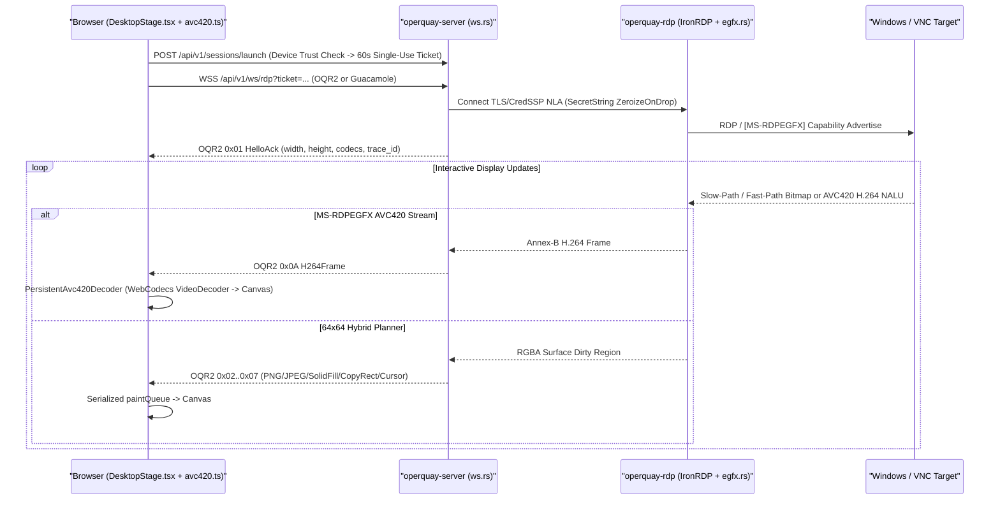

# ADR-0007: Low-Latency Binary Transport (`operquay-rdp-v2`), OpenTelemetry SLOs & Design-System Settings Architecture

## Status

Accepted & Implemented (`OQR2` Framing, `[MS-RDPEGFX]` `AVC420` `0x0A H264Frame` + `PersistentAvc420Decoder`, Serialized `DesktopStage.tsx` Paint Queue, `RdpDesktopClient.tsx` & `TelemetryHub` Live)

## Date

2026-11-19 (Updated from 2026-11-16 initial baseline)

## Context

While Apache Guacamole text instruction framing (`LEN.VAL;`) works reliably for `.guac` audit recording (`ADR-0001`), base64 bitmap serialization adds ~33% bandwidth overhead and browser string allocation churn, while asynchronous `createImageBitmap` calls in a naive canvas consumer can race out of order under high update rates.

## Implemented Decisions

### 1. Dual-Protocol WebSocket Engine (`/api/v1/ws/rdp`)

- **`"guacamole"`**: Length-prefixed UTF-8 frames matching `.guac` audit recordings.
- **`"operquay-rdp-v2"` (`OQR2` Binary Framing, `crates/operquay-display/src/oqr2.rs`)**:
  - Binary header (`magic = *b"OQR2"`, `msg_type: u8`, `flags: u8`, `seq: u32`, `payload...`):
    - `0x01 HelloAck`: negotiated capabilities (`width`, `height`, `cursor_prediction`, `codecs`, `trace_id[16]`).
    - `0x02 TilePng` / `0x03 TileJpeg`: raw compressed bytes without base64 bloat.
    - `0x04 SolidFill`: `(layer, x, y, w, h, rgba[4])` (17 bytes).
    - `0x05 CopyRect`: zero-pixel scroll acceleration.
    - `0x06 CursorShape` / `0x07 CursorMove`: asynchronous hardware pointer separation for zero-RTT local overlay cursor rendering.
    - `0x08 StatsSync`: live telemetry (`server_ts_ms`, `processing_lag_ms`, `fps`, `jpeg_quality`, `dropped_frames`, `active_codec`, `bytes_per_sec`).
    - `0x0A H264Frame`: `[MS-RDPEGFX]` `AVC420` Annex-B H.264 NAL unit pass-through from `operquay-rdp` (`egfx.rs`) via `ws.rs` to browser `PersistentAvc420Decoder` (`frontend/src/rust-engines/avc420.ts`, `WebCodecs` `VideoDecoder`), seamlessly falling back to the 64x64 hybrid planner if `VideoDecoder` is unsupported.

### 2. Browser Desktop Stage (`RdpDesktopClient.tsx` & `DesktopStage.tsx`)

- Renamed legacy `GuacamoleClient` wrapper to **`RdpDesktopClient`** ([frontend/src/components/rdp/RdpDesktopClient.tsx](../../frontend/src/components/rdp/RdpDesktopClient.tsx)) backed by [`DesktopStage.tsx`](../../frontend/src/rust-engines/DesktopStage.tsx).
- **Serialized `paintQueue`**: All canvas resize, `SolidFill`, `CopyRect`, and async `createImageBitmap` tile draws execute sequentially through `paintQueue`, eliminating out-of-order tile tearing.
- **Explicit Error Visibility**: Handles `ws.onerror` and premature `ws.onclose` (before `hello_ack` or unexpected disconnect) cleanly with visible user alerts instead of hanging blank.

### 3. Goal-Based Network Presets & Settings Validation

Four research-backed operator presets (`auto_adaptive`, `ultra_low_latency`, `balanced_wan`, `constrained_wan`) map latency/RTT behavior (`quality(lag)` curve and `max_unacked_frames`) cleanly, backed by matching backend (`operquay-core`) and frontend (`zod`) validation bounds (`FPS [10, 60]`, JPEG quality `[20, 95]`, resize `[200, 8192]` with even width).

### 4. OpenTelemetry & Prometheus Observability (`operquay-telemetry`)

- W3C `traceparent` / `trace_id` propagation bound to every HTTP request and WebSocket session, emitted in structured JSON logs and `/metrics`:
  - `operquay_sessions_started_total`, `operquay_active_sessions`, `operquay_frames_encoded_total`, `operquay_frames_dropped_total`, `operquay_frame_encode_duration_ms`, `operquay_input_rtt_ms`, `operquay_settings_updates_total`.
- Zero-secret discipline: `SecretString` redacts credentials at `Debug`/`Display` and high-cardinality PII (`user_id`, `ip`, `sql`) stays out of Prometheus labels.

## Consequences

- **Positive**: Live `OQR2` streaming + `DesktopStage.tsx` renders crisp Windows RDP frames cleanly over strict TLS (`5444`) with deterministic tile ordering and clear WebSocket failure alerts.
- **Trade-off**: Using server-side `ironrdp-*` crates means interactive desktop sessions depend on the `operquay-rdp` + `IronRDP` connector stack while preserving protocol-agnostic `DisplaySink` + `OQR2` transport underneath.

## SOC 2 Type II & ISO/IEC 27001:2022 Compliance Alignment

- **Privacy & Secret Hygiene (`SOC 2 CC6.7, C1.1` | `ISO A.8.11, A.8.12`)**: Zero secrets in `OQR2` frames, OpenTelemetry spans, Prometheus labels, or browser `localStorage`; desktop connections use single-use `60s` tickets after upfront authorization checks.
- **Traceability & Availability (`SOC 2 CC7.1, A1.2` | `ISO A.8.15, A.8.16`)**: End-to-end `trace_id` correlation links browser session errors, TLS handshake warnings, backend `ws.rs` metrics, and `audit_events` for rapid incident triage.

## Verification Gates

1. `cargo test -p operquay-display` & `cargo test -p operquay-server`: `OQR2` binary frame encoding/decoding and WebSocket upgrade + `HelloAck` tests.
2. `pnpm --dir frontend run test`: `RdpDesktopClient.test.tsx` verifying premature WebSocket close alert behavior, serialized `paintQueue`, and `SETTINGS_SECTIONS` schema validation.
