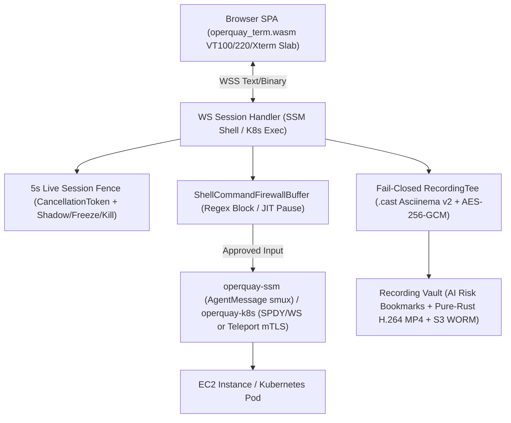

# ADR-Rust 0008: Pure-Rust WASM Terminal Engine (`operquay-term`) & Single-Binary Platform Parity

## Status

Accepted & Implemented (Pure-Rust WASM Terminal + 20-Crate Control Plane with M9–M12 Compliance, Persistence & Governance Hardening Live)

## Date

2026-11-19

## Context

Legacy Operquay relied on Go backend handlers (`20` Go ADRs across auth, AWS, SSM, Kubernetes, DB workspace, suggestions, LLM, audit, licensing) paired with JavaScript/Zig browser terminal dependencies (`@xterm/xterm`, `@wterm/dom`) and external processes (`tsh`, `aws`, `session-manager-plugin`, `guacd`). To deliver a single `#![forbid(unsafe_code)]` Rust binary + static SPA with zero external runtimes, both the browser terminal core and all backend platform subsystems were ported to Rust.

## Decision & Implemented Platform Surface

1. **Zero-`unsafe` Rust & WASM Terminal (`crates/operquay-term`, `crates/operquay-term-wasm`)**:
   - Implements VT100/VT220/Xterm CSI/OSC/DCS parsing, SGR 16/256/TrueColor attributes, primary + alternate screen buffers, `DECSTBM` scroll regions, `DECSC`/`DECRC`, Unicode wide-character width calculation (`unicode-width`), bracketed paste (`?2004`), application cursor keys (`?1`), mouse tracking (`?1000/1002/1006`), scrollback regex/text search, and `serialize_vt()` state dump inside `#![forbid(unsafe_code)]` Rust.
   - Compiles to `operquay_term.wasm` (`wasm32-unknown-unknown`) using safe `RefCell<Slab>` register-packed ABI entrypoints (`oqr_term_feed32`) returning read-only `(ptr, len)` descriptors—zero `wasm-bindgen` bloat and zero `unsafe` blocks.
   - Server-side `operquay-recording` reuses `operquay-term` VT emulation inside `transcode_cast_to_mp4` (`h264_mp4.rs`).
2. **Modular 19-Crate Platform Parity**:
   - `operquay-auth`: tenant extraction with `TRUSTED_PROXIES`, `bcrypt`/`Argon2id`, `auth_sessions` (`__Host-` + CSRF + HSTS/CSP), RBAC deny-overrides/conditions, groups, IdP mappings, OIDC JWKS + PKCE, SAML 2.0 XML-DSig/c14n verification, WebAuthn/TOTP MFA, lockout/rotation, SCIM v2 (`/scim/v2/*`).
   - `operquay-aws`: `hub`/`profiles`/`user` modes persisted in PG RLS, AES-GCM OS CSPRNG encrypted AWS stores, SSO device auth with portal pacing (`portal_sem=2` + `429` retry), EC2/ELB **discovery/fetch**, instance metrics, saved inventory, bounded SSM shell + fail-closed `.cast` recording + 5s live fence termination, SSM `SendCommand` + S3 transfers, AMI clone, and `petgraph` VPC topology analyzer.
   - `operquay-suggest` & `operquay-llm` + MCP Proxy: AES-GCM encrypted command buckets + Trie/frecency/MLP/ErrorKB; multi-provider SSE (`Bedrock`, `Anthropic`, `OpenAI`, `Gemini`, `Ollama`) with `safety.rs` PII & dangerous-command guardrails + `/api/mcp/rpc` ISO 42001 proxy (`oqmcp_` tokens, sponsor binding, JIT & DLP).
   - `operquay-k8s`: cluster registry, EKS STS presigned token, kubeconfig unsafe-exec blocklist, Helm release parser, workload metrics/cost endpoints, `K8sRecordingPolicy`, real SPDY/WS `exec`/`attach` with fail-closed `.cast`, and Teleport mTLS/gRPC integration.
   - `operquay-db`, `operquay-forward`, `operquay-license`, `operquay-agent`: 5-engine `DatabaseEngineDriver` (with enforced MySQL/Redis TLS + PII DLP), 5-byte forward mux + CLI (`login`/`ssh`/`db`/`kube`/`forward`/`mcp`), outbound-mTLS `operquay-agent` daemon, and Ed25519 entitlement verifier (`operquay licensectl`) + Stripe webhook handler.

3. **Frontend Single-Page App (`frontend/`)**:
   - Built with React 19 + Vite, semantic Dark/Light Deep Teal tokens, embedded `operquay_term.wasm`, async SSH WebSocket error handling (`ws.ts` + `Xterm.tsx`), `RdpDesktopClient.tsx` + `DesktopStage.tsx`, `CloudConnections.tsx` SSO retry UX, and full workspace views (VMs, Topology, K8s, Multi-DB, Recordings, Audit Log, Admin, `Cmd+K` Palette).

## Consequences

- **Positive**: One cohesive `#![forbid(unsafe_code)]` Rust codebase replaces Go, Node, Zig/C terminal shims, and external converters; real-only session execution removes misleading mock fallbacks.
- **Compliance & Governance (`M9`–`M12`)**: Closed initial security gaps (`SAML`/`OIDC` signatures, MySQL/Redis TLS, fail-closed RLS, Teleport/K8s depth) and delivered JIT ZSP, Command Firewall, DB DLP, MCP Proxy, hybrid reverse tunnels, Access Graph, Device Trust, CLI, and Terraform provider in [ADR-0010](./0010-soc2-iso27001-security-and-zero-standing-privileges.md)–[ADR-0012](./0012-mcp-proxy-hybrid-agent-multicloud-sso-access-graph-and-device-trust.md).

## SOC 2 Type II & ISO/IEC 27001:2022 Compliance Alignment

- **Code Safety & Feature Integrity (`SOC 2 CC7.1, CC8.1` | `ISO A.8.25, A.8.28`)**: Zero `unsafe` Rust code in both backend and browser WASM prevents parser memory-corruption vulnerabilities; AI guardrails (`safety.rs`) prevent accidental credential leakage to external LLM providers (`ISO A.8.12`).
- **Compliance Matrix (`M9`–`M12`)**: All parity subsystems follow the per-feature SOC 2 / ISO 27001 matrix in [RULES.md §7](../../RULES.md#7-per-feature-soc-2--isoiec-270012022-compliance-matrix).

## Verification Gates

1. `cargo test --workspace` (`20` workspace crates, including `operquay-term` ANSI/VT/scrollback/search suite & `operquay-server` M9–M12 route suites).
2. `pnpm --dir frontend run typecheck && pnpm --dir frontend run lint && pnpm --dir frontend run test && pnpm --dir frontend run build` (clean Vite + `operquay_term.wasm` bundle).
