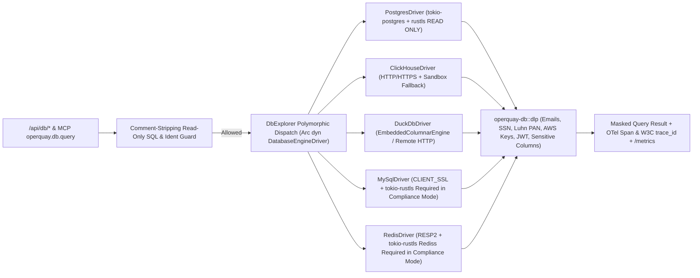

# ADR-Rust 0009: Object-Oriented Multi-Database Architecture & Deep OpenTelemetry Observability

## Status

Accepted & Implemented (`DatabaseEngineDriver` Trait, 5 Drivers with Mandatory MySQL/Redis TLS 1.2+ & Native DuckDB Support, Read-Only SQL Guards, Inline PII DLP Masking & `TelemetryHub` Live)

## Date

2026-11-19 (Updated from 2026-11-18 initial draft)

## Context

Legacy Operquay supported only PostgreSQL in its Database Workspace Explorer. Modern engineering environments query PostgreSQL, ClickHouse, DuckDB, MySQL/MariaDB, and Redis, while compliance and SRE teams require unified W3C `trace_id` propagation, low-cardinality metrics, and strict read-only query guardrails across all data engines.

## Decision & Implemented Design (`crates/operquay-db` + `crates/operquay-telemetry` + `crates/operquay-server/src/stores.rs`)

1. **Object-Oriented Driver Polymorphism (`crates/operquay-db/src/driver.rs`)**:
   - `#[async_trait] pub trait DatabaseEngineDriver: Send + Sync` standardizes schema introspection (`connect_and_inspect`), guarded query execution (`execute_query`), raw mutation (`execute_sql_mutation`), and structured table updates (`execute_structured_mutation`).
   - Five concrete drivers register inside `DbExplorer`:
     - `PostgresDriver` (`postgres_driver.rs`): `tokio-postgres` + `tokio-rustls`, local/container host resolution, PK/size introspection, `READ ONLY` transaction wrapper, type-cast parameterized mutations.
     - `ClickHouseDriver` (`clickhouse_driver.rs`): HTTP/HTTPS (`8123`/`8443`) `JSON` driver introspecting `system.databases`/`tables`/`columns` with `readonly=1` + embedded sandbox fallback for `memory://`/`embedded://`.
     - `DuckDbDriver` (`duckdb_driver.rs`): Analytical SQL engine (`memory://`/`embedded://`, local file store, and remote HTTP adapter).

     - `MySqlDriver` (`mysql_driver.rs`): Pure-Rust MySQL v10 wire-protocol driver (`COM_QUERY`). **Gap**: currently connects over plaintext `TcpStream` (`mysql_driver.rs:48-55`) without `CLIENT_SSL` TLS upgrade.
     - `RedisDriver` (`redis_driver.rs`): Pure-Rust RESP2 client with keyspace `SCAN`/preview. **Gap**: currently connects over plaintext `TcpStream` (`redis_driver.rs:58-67`) without `tokio-rustls` Rediss TLS upgrade.
2. **Unified Control-Plane Storage (`stores.rs`)**:
   - Control-plane repositories (`SettingsStore`, `AuditRepository`, `StorageBackend`) support PostgreSQL (`tokio-postgres` + RLS), ClickHouse HTTP sink, DuckDB analytical ledger, or bounded In-Memory storage.
3. **Read-Only Guard & Mutation Identifier Validation**:
   - Strips leading SQL comments (`--`, `/* ... */`) before detecting write/DDL statements (`INSERT`, `UPDATE`, `DELETE`, `DROP`, `ALTER`, `CREATE`, `TRUNCATE`, `GRANT`, `REVOKE`, `MERGE`, `COPY`, `VACUUM`, `ATTACH`, `DETACH`) and blocks them on `/api/db/query` (`blocked_by_guard: true`).
   - Structured mutations strictly validate identifiers (`^[A-Za-z_][A-Za-z0-9_]*$`).
4. **OpenTelemetry Instrumentation (`operquay-telemetry`)**:
   - Emits low-cardinality Prometheus metrics (`operquay_db_queries_total`, `operquay_db_query_duration_ms`, `operquay_ssm_tunnels_total`, `operquay_auth_events_total`, `operquay_k8s_requests_total`, `operquay_ai_requests_total`) + W3C trace correlation (`trace_id`/`span_id`) in structured JSON logs and HTTP response `x-trace-id` headers.

## Hardening & Inline DLP Implemented in M9–M11

1. **Mandatory Driver TLS (`RULES.md` §3.3, Implemented in M9)**: `MySqlDriver` (`CLIENT_SSL` + `tokio-rustls`) and `RedisDriver` (`tokio-rustls` Rediss) enforce TLS 1.2+ with `StrictCa` / `TofuPinned` by default, rejecting plaintext DB credential transmission in Compliance Mode.
2. **Inline Result DLP / PII Masking (`RULES.md` §7, Implemented in M11)**: `operquay-db::dlp` masks sensitive columns and matches (emails, SSN, Luhn PAN, AWS keys, JWTs, secrets) across query rows before returning responses or MCP tool outputs.

## Consequences

- **Positive**: Clean polymorphic `DatabaseEngineDriver` seam avoids SQL dialect branching inside `platform_routes.rs` and unifies 5 engines in `DatabasesWorkspace.tsx` with mandatory TLS and inline PII redaction.
- **Compliance Managed**: Dev-only plaintext mode requires explicit opt-in (`insecure_allow_plaintext_dev`) and is rejected under Compliance Mode.

## SOC 2 Type II & ISO/IEC 27001:2022 Compliance Alignment

- **Logical Access & Integrity (`SOC 2 CC6.1, CC6.6, PI1.4` | `ISO A.8.3, A.8.24, A.8.28`)**: Read-only SQL comment-stripping guard + engine-native `READ ONLY` transactions + mandatory `tokio-rustls` TLS across PostgreSQL, MySQL, and Redis protect data confidentiality and integrity.
- **Database Audit Trail (`SOC 2 CC7.2` | `ISO A.8.15`)**: Every `db_connect`, `db_query`, and `db_mutate` call emits OpenTelemetry spans (`trace_id`), DLP masking metadata, and hash-chained audit records attributing user, role, target database, and outcome.

## Verification Gates

1. `cargo test -p operquay-db` and `cargo test -p operquay-server`: SQL comment-stripping write-block tests (`/* ... */ INSERT`), identifier validation, 5-driver metadata/query contracts, `MySqlDriver`/`RedisDriver` TLS rejection when `insecure_allow_plaintext_dev` is unset, and `operquay-db::dlp` PII redaction.
2. `cargo test -p operquay-telemetry` & `/metrics` Prometheus exposition check.
