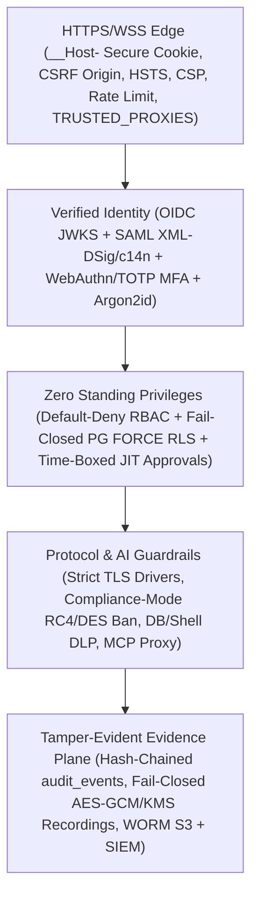
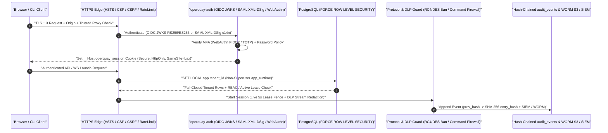

# ADR-Rust 0010: SOC 2 Type II, ISO/IEC 27001:2022 Security Architecture & Zero Standing Privileges (ZSP)

## Status

Accepted & Implemented (M9–M12 Security & ZSP Controls Live; Governed by `RULES.md` §3 & §7)

## Date

2026-11-19

## Context

For Operquay to compete head-to-head with Teleport, StrongDM, HashiCorp Boundary, and Hoop.dev in commercial enterprise deployments, passing **SOC 2 Type II** (`CC6`, `CC7`, `CC8`, `CC9`, `A1.2`, `C1.1`, `PI1.4`) and **ISO/IEC 27001:2022** (`Annex A.5` & `Annex A.8`) audits is a hard go-to-market prerequisite.

A pre-remediation security audit (`M8` baseline) identified critical P0 gaps across identity verification, cookies/proxies/RLS, crypto/TLS hygiene, and mutable audit trails. Every audited gap listed below has now been remediated across **M9–M12**:

1. **Identity & Token Verification (Remediated in M9)**:
   - SAML 2.0 responses now undergo pure-Rust XML-DSig `<ds:Signature>` verification (Exclusive c14n + `sha2`/`rsa`/`ecdsa`/`p256` against pinned IdP X.509 certs), strict single-assertion containment, and assertion replay checks.
   - OIDC tokens verify cryptographic signatures via IdP JWKS (`RS256`/`ES256`/`EdDSA`, rejecting `alg: none` and HMAC confusion) plus `iss`, `aud`, `exp`, `nbf`, and `nonce`.
   - Local auth enforces MFA (`WebAuthn` FIDO2 + `TOTP`), IP/account login rate-limiting and lockout, forced initial admin password rotation, and `bcrypt >= 12` / `Argon2id`.
2. **HTTP Cookies, Headers, Proxies & Multi-Tenancy (Remediated in M9)**:
   - Session cookies set `__Host-operquay_session` (`Secure; HttpOnly; SameSite=Lax` when on HTTPS), paired with explicit `Origin` checks on mutations and WebSocket upgrades.
   - Middleware injects `Strict-Transport-Security`, strict `Content-Security-Policy`, `Permissions-Policy`, `X-Content-Type-Options: nosniff`, and `X-Frame-Options: SAMEORIGIN`.
   - `TRUSTED_PROXIES` CIDR allowlist gates `X-Forwarded-For` / `X-Real-IP` / `X-Operquay-Tenant` trust.
   - PostgreSQL migrations enforce `FORCE ROW LEVEL SECURITY` with fail-closed `tenant_id = NULLIF(current_setting('app.tenant_id', true), '')` under non-superuser `app_runtime`.
3. **Cryptography, Database TLS & Session Integrity (Remediated in M9)**:
   - `operquay-auth::crypto` uses 96-bit OS CSPRNG nonces (`fill_csprng` / `OsRng`), `key_version` metadata, and envelope encryption support.
   - `MySqlDriver` (`CLIENT_SSL` + `tokio-rustls`) and `RedisDriver` (`tokio-rustls`) enforce TLS 1.2+ by default.
   - `OPERQUAY_COMPLIANCE_MODE` blocks legacy RC4 RDP and plaintext VNCAuth DES unless explicitly allowlisted inside an encrypted SSM tunnel and audited.
   - SSM/K8s/RDP/VNC streams use bounded channels, fail-closed `.cast`/`.guac` recording tees, and 5-second shared `CancellationToken` fence watchers.
4. **Tamper-Evident Audit, WORM Recordings & Persistence (Remediated in M10)**:
   - `audit_events` maintains a cryptographic `seq` / `prev_hash` / `entry_hash` SHA-256 chain with `REVOKE UPDATE, DELETE`, live `/api/v1/audit/verify`, and SIEM export (`/api/v1/audit/siem/status`).
   - AWS SSO flows, role leases, and recordings persist cleanly with AES-256-GCM encryption at rest and WORM S3 Object Lock export support.

## Decision

Establish a **defense-in-depth SOC 2 Type II + ISO/IEC 27001:2022 Security & Zero-Standing-Privileges (ZSP) Architecture** structured across Milestones **M9–M12** in [tasks.md](../../tasks.md) and codified as mandatory rules in [RULES.md §3 & §7](../../RULES.md):

### End-to-End Cryptographic Defense Sequence

### Architectural Specifications

1. **Cryptographic SSO Verification (Pure Rust, Zero C `xmlsec1`)**:
   - **SAML 2.0**: Validate XML-DSig `<ds:Signature>` using pure-Rust DOM/canonicalization over `roxmltree` + Exclusive c14n + `sha2`/`rsa`/`ecdsa`/`p256` against pinned IdP X.509 certificates; enforce strict single-assertion schema containment (anti-XSW), replay-protected `AssertionID` cache, `InResponseTo`, `Audience`, `Recipient`, and `NotBefore`/`NotOnOrAfter` skew bounds.
   - **OIDC**: Fetch & cache IdP JWKS (`Cache-Control` + kid rotation), verify RS256/ES256/EdDSA signatures strictly (reject `alg: none` & HS confusion), and check `iss`, `aud`, `exp`, `nbf`, `nonce`.
2. **Zero-Trust Multi-Tenancy & Trusted Edge**:
   - Migrate PostgreSQL RLS to `ALTER TABLE ... FORCE ROW LEVEL SECURITY` with `tenant_id = NULLIF(current_setting('app.tenant_id', true), '')` (`app_runtime` non-superuser role owning zero `BYPASSRLS` privileges).
   - Parse `TRUSTED_PROXIES` CIDRs at startup (`main.rs`); ignore forwarded IP/proto/tenant headers from untrusted peers.
   - Enforce `__Host-` `Secure; HttpOnly; SameSite=Lax`, explicit `Origin` checks on mutations/WS, per-account/IP brute-force lockout, forced initial admin password rotation, Argon2id / `bcrypt >= 12`, and MFA (`WebAuthn` FIDO2 / `TOTP`).
3. **Cryptographic Hygiene & Driver/Protocol Hardening**:
   - Generate 96-bit AES-256-GCM nonces from OS CSPRNG (`getrandom` / `OsRng`), version master/DEK keys (`key_id`), and support external AWS KMS / Vault envelope wrapping.
   - Upgrade `MySqlDriver` (`CLIENT_SSL` + `tokio-rustls`) and `RedisDriver` (`tokio-rustls`) to require TLS 1.2+ by default.
   - Introduce `OPERQUAY_COMPLIANCE_MODE=true` (recommended prod default): rejects Standard RDP RC4, non-TLS raw VNCAuth DES, insecure `skip_tls_verify`, and unrecorded privileged sessions.
   - Wire bounded channels (`mpsc::channel`), fail-closed `.cast` `RecordingTee`, and 5-second shared `CancellationToken` fence watchers into every SSM/RDP/VNC/K8s task.
4. **Tamper-Evident Append-Only Audit & Encrypted WORM Evidence**:
   - Extend `audit_events` with `seq BIGSERIAL`, `prev_hash BYTEA`, `entry_hash BYTEA`, `key_id TEXT`, HMAC/SHA-256 chain computation inside a serialized/locked TX or partition chain, `REVOKE UPDATE, DELETE` for application DB roles, plus a verification endpoint `/api/v1/audit/verify`.
   - Encrypt `.guac` / `.cast` / `.mp4` artifacts at rest via streaming AES-256-GCM DEK wrapped by master/KMS key, write SHA-256 manifests, stream real-time events to SIEM (`OTLP` / `Splunk HEC` / `Syslog RFC 5424`), and archive to S3 Object Lock (`WORM`).
5. **Just-In-Time (JIT) ZSP & AI / MCP Governance (M11–M12)**:
   - Implement ephemeral JIT elevation workflows (`POST /api/access-requests` -> Slack/Teams/PagerDuty webhook -> peer approval -> time-boxed lease auto-expiring with 5s live fence kill).
   - Extend Operquay's gateway (`operquay-llm` + `operquay-ssm` + `operquay-db`) to act as a **Model Context Protocol (MCP) & AI Agent Zero-Trust Proxy**, binding every autonomous agent token to an accountable human sponsor, per-tool RBAC/JIT approval, PII/secret redaction, and immutable prompt/tool audit logs.

## Consequences

- **Positive**: Transforms Operquay from a technically fast single-binary gateway into an enterprise-auditable, SOC 2 Type II & ISO 27001-ready PAM & Zero-Trust Access platform with strong differentiation against Teleport, StrongDM, Boundary, and Hoop.dev.
- **Cost / Trade-off**: Strict compliance defaults (MFA, fail-closed recording, no plaintext DB connections, RC4/DES block) require explicit bootstrap UX (`dev-insecure` explicit flag vs `prod` compliance profile) so local developer onboarding remains frictionless via `mkcert` while production ships locked down.

## SOC 2 Type II & ISO/IEC 27001:2022 Mapping Summary

- **SOC 2 CC6.1–CC6.7** (`Logical Access`, `MFA`, `Boundary`, `Transmission Crypto`) -> `§3.1–3.4` ([RULES.md](../../RULES.md)), **M9**.
- **SOC 2 CC7.1–CC7.3, CC8.1, A1.2, C1.1, PI1.4** (`Monitoring`, `Change Management`, `Availability`, `Confidentiality`, `Processing Integrity`) -> `§3.5–3.6`, **M10–M11**.
- **ISO/IEC 27001:2022 Annex A.5 & A.8** (`A.5.15`, `A.5.18`, `A.5.33`, `A.8.2`, `A.8.3`, `A.8.5`, `A.8.8`, `A.8.11–A.8.16`, `A.8.20`, `A.8.24`, `A.8.25`, `A.8.28`, `A.8.32`) -> [RULES.md §7 Matrix](../../RULES.md#7-per-feature-soc-2--isoiec-270012022-compliance-matrix).

## Verification Gates

1. Automated security regression suite in `operquay-auth`, `operquay-db`, `operquay-ssm`, `operquay-recording`, and `operquay-server`: SAML signature tamper test, OIDC invalid-`iss`/`alg=none` test, PG fail-closed unset-tenant test, spoofed `X-Forwarded-For` test, MySQL/Redis plaintext rejection test, fail-closed `.cast` test, `< 5s` live fence termination test, and `audit_events` hash-chain verification test.
2. CI supply-chain gate: `gitleaks`, `cargo audit`, `cargo deny check`, `pnpm audit`, SBOM + `cosign` verification.
