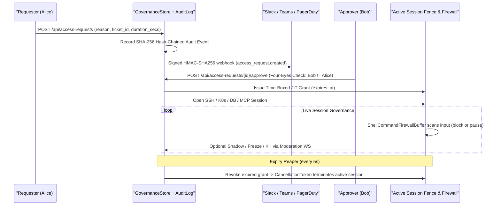
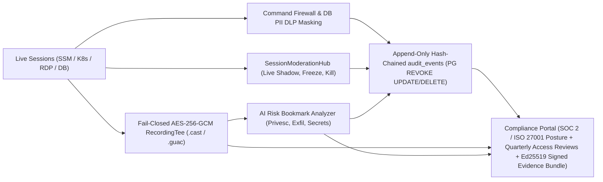

# ADR-Rust 0011: Just-In-Time (JIT) Access, Live Session Moderation, Inline DLP & Compliance Portal

## Status

Accepted & Implemented (`M11.1`–`M11.4` Live in `operquay-server`, `operquay-db`, `operquay-ssm`, `operquay-k8s`, `operquay-llm` & Frontend Governance Panels)

## Date

2026-11-19

## Context

Zero Standing Privileges (`ZSP`), dual-control session oversight, inline sensitive-data protection, and verifiable continuous compliance evidence are mandatory for regulated SOC 2 Type II and ISO/IEC 27001:2022 deployments. Relying on static role assignments or post-hoc manual log review leaves privileged shell, Kubernetes, database, and desktop access over-exposed between audits.

## Decision

Implement an integrated four-part real-time governance & compliance control plane inside the single `operquay` binary backed by tenant-isolated PostgreSQL (`FORCE ROW LEVEL SECURITY`) and append-only hash-chained `audit_events`:

### 1. JIT Access Requests, Four-Eyes Approval & 5s Live Fence (`crates/operquay-server/src/jit.rs`, `governance_routes.rs`)

- **Request Workflow**: Users request temporary elevation via `POST /api/access-requests` specifying target resource/scope, justification reason, optional change-ticket reference (`ticket_id`), and requested `duration_secs`.
- **Four-Eyes Approval**: Peers with approval permission review via `POST /api/access-requests/{id}/approve`, `POST /api/access-requests/{id}/deny`, or `POST /api/access-requests/{id}/revoke` (self-approval is strictly rejected).
- **External Approval Webhooks**: `POST /api/governance/webhooks` configures signed HMAC-SHA256 outbound webhooks (Slack, Microsoft Teams, PagerDuty, Jira/ServiceNow, generic JSON) and accepts signed interactive decision callbacks on `/api/access-requests/webhooks/{provider}/callback`.
- **Live 5s Expiry Reaper**: Every active SSM, K8s, RDP, and VNC stream registers a `CancellationToken` fence watched on a `<= 5s` interval so JIT expiry or manual revocation terminates active sessions immediately.

### 2. Dual-Control Moderation, Command Firewall, Inline DLP & AI Risk Bookmarks

- **Live Moderation Hub (`GET /api/sessions/live`, `/api/sessions/{id}/freeze`, `/api/sessions/{id}/kill`)**: Authorized reviewers observe active sessions in real time, freeze interactive input (`freeze`), or force-terminate streams (`kill`) with an attributed audit record.
- **Inline Shell Command Firewall (`ShellCommandFirewallBuffer`)**: Inspects terminal commands in-flight against tenant DLP policies (`/api/governance/dlp-policy`, `/api/governance/dlp-policy/test`) to block or pause destructive commands (e.g., destructive disk wipes, recursive deletes, unauthorized curl-pipe-shell) pending moderator/JIT release.
- **Database Result PII DLP (`operquay-db::dlp`)**: Masks sensitive columns and regex matches (emails, SSNs, Luhn PAN credit cards, AWS keys, JWTs, bearer tokens) across PostgreSQL, ClickHouse, DuckDB, MySQL, and Redis query results.
- **AI Risk Bookmarks (`operquay-llm`)**: Scans recorded `.cast` / session transcripts automatically with sanitized context to tag privilege-escalation, secret-disclosure, and exfiltration timestamps for fast auditor playback.

### 3. Continuous Compliance & Auditor Evidence Portal

- **Posture & Quarterly Access Reviews**: `GET /api/compliance/posture`, `GET/POST /api/compliance/access-reviews`, and `POST /api/compliance/access-reviews/{id}/items/{item_id}` track control readiness across SOC 2 (`CC6`, `CC7`, `CC8`, `A1.2`, `C1.1`, `PI1.4`) and ISO/IEC 27001:2022 (`Annex A.5` & `A.8`) alongside break-glass alerting.
- **Signed Evidence Bundles (`POST /api/compliance/evidence-bundle`, `POST /api/compliance/evidence-bundle/verify`)**: Packages posture snapshots, access-review attestations, audit chain verification status, and policy metadata into a deterministic JSON bundle signed with the cluster's Ed25519 evidence keypair for independent verification.

## Consequences

- **Positive**: Replaces standing admin access with auditable ephemeral JIT grants, prevents accidental/malicious PII exposure in SQL/MCP outputs, and shrinks external auditor evidence collection from days to one signed bundle export.
- **Trade-off**: Strict four-eyes approval blocks solo self-approval even for admins unless break-glass controls are invoked and logged out-of-band.

## SOC 2 Type II & ISO/IEC 27001:2022 Compliance Alignment

- **`SOC 2 CC6.2, CC6.3` | `ISO A.5.15, A.5.18`**: Quarterly access reviews, four-eyes JIT grants, and automated `<= 5s` expiry revocation.
- **`SOC 2 CC7.1, CC7.2, C1.1` | `ISO A.5.33, A.8.11, A.8.12, A.8.15, A.8.16`**: Live freeze/kill moderation, Command Firewall, DB/MCP PII masking, fail-closed encrypted recordings, and Ed25519-signed evidence bundles.

## Verification Gates

1. `cargo test -p operquay-server`: End-to-end integration tests covering four-eyes self-approval rejection, HMAC webhook callback verification, live freeze/kill session termination, DLP policy redaction, quarterly access reviews, and Ed25519 evidence bundle sign/verify roundtrips.
2. Frontend Vitest suite + strict-TLS live API check (`/api/v1/audit/verify`).
