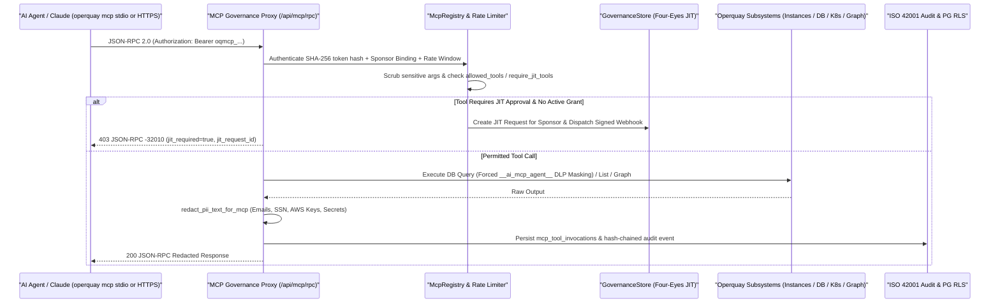
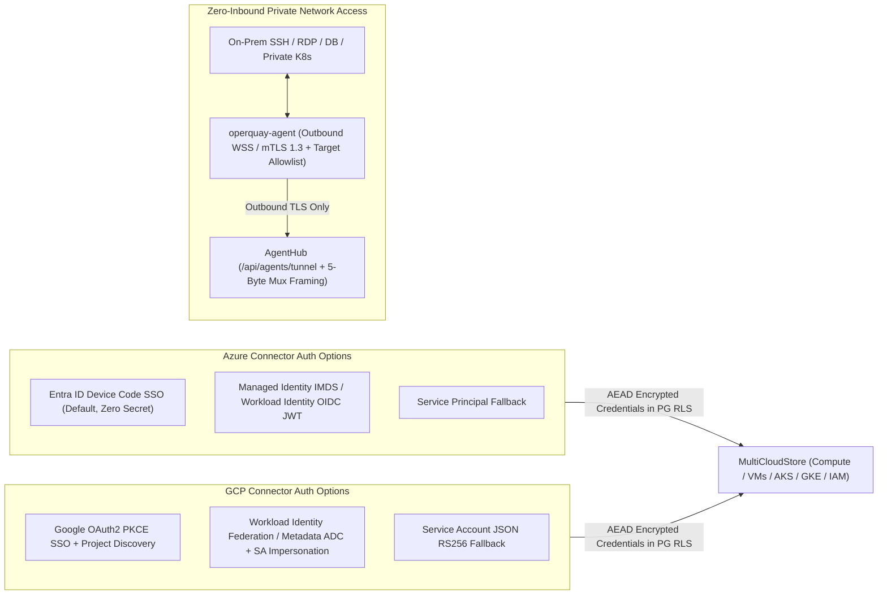
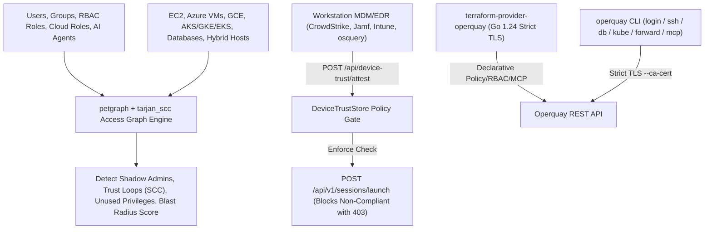

# ADR-Rust 0012: AI/MCP Governance Proxy, `operquay-agent` Hybrid Tunnel, Multi-Cloud Secretless SSO, Access Graph & Device Trust

## Status

Accepted & Implemented (`M12.1`–`M12.5` Live Across Workspace Crates, `operquay-agent`, `terraform-provider-operquay` & React 19 UI Panels)

## Date

2026-11-19

## Context

Enterprise teams increasingly run coding/ops AI agents alongside multi-cloud workloads (AWS, Microsoft Azure, Google Cloud) and private on-premises/VPC infrastructure behind restrictive firewalls. Standard bastions leave five critical gaps:
1. Unmanaged AI assistants holding long-lived credentials with direct DB/cloud access and zero tool-level audit (`ISO/IEC 42001`).
2. Inbound NAT/firewall rules required to reach private VPC or on-premises targets.
3. Multi-cloud connectors forcing admins to copy-paste static Azure Client Secrets or GCP Service Account JSON keys instead of interactive secretless SSO or workload identity federation.
4. Fragmented IAM visibility across users, groups, RBAC roles, cloud roles, AI agents, and compute/DB/K8s assets.
5. Workstation posture checks and hardware-accelerated H.264 RDP missing from browser remoting.

## Decision

Deliver five cohesive `M12` subsystems inside the `#![forbid(unsafe_code)]` Rust workspace plus a pure-Go Terraform/OpenTofu provider:

### 1. AI Agent & Model Context Protocol (MCP) Zero-Trust Proxy (`M12.1`, `crates/operquay-server/src/m12_routes.rs`)

- **Sponsor-Bound Agent Credentials**: `McpRegistry` registers AI agents (`/api/mcp/agents`), issuing short-lived `oqmcp_...` bearer tokens stored only as SHA-256 digests and cryptographically bound to an accountable human sponsor (`sponsor_user_id`), allowed tools (`allowed_tools`), per-minute rate caps, and tools requiring interactive human JIT approval (`require_jit_tools`).
- **JSON-RPC 2.0 Enforcement & Redaction (`POST /api/mcp/rpc`, `GET /api/mcp/invocations`, `operquay mcp`)**:
  - Evaluates tool RBAC + sliding rate window and scrubs sensitive args before logging.
  - When a tool requires JIT approval without an active grant, creates a JIT request via `GovernanceStore`, dispatches webhooks, and returns JSON-RPC `-32010` (`jit_required: true`, `jit_request_id`).
  - Forces `__ai_mcp_agent__` DLP masking on SQL tool execution and passes all tool outputs through `redact_pii_text_for_mcp` (masking emails, SSNs, AWS keys, secrets) while persisting ISO 42001 audit events and `mcp_tool_invocations`.

### 2. Zero-Inbound Hybrid Reverse Tunnel (`operquay-agent`, `M12.2`) & Secretless Multi-Cloud SSO (`M12.3`)

- **`operquay-agent` (`crates/operquay-agent`, `AgentHub` `/api/agents/*`)**: Lightweight outbound-only WSS/mTLS daemon connecting from private VPCs or on-premises networks to `GET /api/agents/tunnel`, multiplexing TCP streams with 5-byte framing after enrollment (`/api/agents/enroll`) and enforcing per-agent `allowed_targets` CIDR/host:port allowlists (`/api/agents/{id}/dial-check`).
- **Azure Secretless SSO & Keyless Auth (`crates/operquay-server/src/multicloud.rs`, `CloudConnections.tsx`)**:
  - **Entra ID SSO (Default)**: RFC 8628 Device Code SSO (`/api/clouds/azure/sso/start`, `/poll`, `/connect`) using the public client ID `04b07795-8ddb-461a-bbee-02f9e1bf7b46` (or custom App ID), automatically discovering Azure subscriptions (`AzureSubscriptionInfo`) with zero stored client secrets.
  - **Managed / Workload Identity**: Passwordless Azure IMDS metadata token or Entra Workload Identity federated OIDC JWT token file (`managed_identity` / `workload_identity`), plus optional **Service Principal Secret** fallback.
- **GCP Secretless SSO & Keyless Auth (`crates/operquay-server/src/multicloud.rs`, `CloudConnections.tsx`)**:
  - **Google Cloud SSO (Default)**: OAuth2 Authorization Code + PKCE `S256` (`/api/clouds/gcp/sso/start`, `/callback`, `/status`, `/connect`), automatically discovering accessible GCP projects after browser approval.
  - **Workload Identity / ADC**: GCE/GKE Metadata ADC (`metadata_adc`) or Workload Identity Federation STS + Service Account impersonation (`workload_identity`), plus optional **Service Account JSON** RS256 fallback.

### 3. Unified Access Graph (`M12.4`), Device Trust, Developer CLI, Terraform & Hardware AVC420 (`M12.5`)

- **Access Graph (`GET /api/access-graph`, `GET /api/access-graph/blast-radius/{principal_id}`)**: Extends `petgraph` + `tarjan_scc` across users, groups, RBAC roles, cloud IAM roles, AI agents, EC2/Azure/GCE VMs, K8s clusters, databases, and hybrid hosts to flag shadow admins, strongly connected trust loops, unused permissions, and per-principal blast radius scores.
- **Device Trust MDM Gate (`GET/PUT /api/device-trust/policy`, `POST /api/device-trust/attest`, `GET /api/device-trust/devices`)**: Evaluates CrowdStrike, Jamf, Intune, or osquery workstation attestations (disk encryption, OS version, EDR active, MDM enrolled, max age) and enforces `403` policy blocks directly inside `POST /api/v1/sessions/launch`.
- **Developer CLI & Terraform Provider**: `operquay` binary supports `login`, `ssh`, `db`, `kube`, `mcp`, `forward`, and `licensectl` with strict TLS `--ca-cert`; `terraform-provider-operquay` (Go) declaratively manages `operquay_role`, `operquay_recording_policy`, `operquay_dlp_policy`, `operquay_mcp_agent`, `operquay_device_trust_policy`, `operquay_cloud_connector`, and `operquay_governance_webhook`.
- **Hardware-Decoded `[MS-RDPEGFX]` `AVC420` RDP**: `operquay-rdp` (`egfx.rs`) forwards H.264 NALUs over `OQR2` opcode `0x0A H264Frame` (`crates/operquay-display/src/oqr2.rs`, `ws.rs`) directly into `PersistentAvc420Decoder` (`frontend/src/rust-engines/avc420.ts` + `DesktopStage.tsx`) using browser `WebCodecs` `VideoDecoder` when supported, seamlessly falling back to the 64x64 hybrid planner.

## Consequences

- **Positive**: Closes the full commercial PAM gap — secretless multi-cloud SSO across AWS/Azure/GCP, zero-inbound hybrid access, ISO 42001 AI/MCP governance, infrastructure-as-code management, workstation posture enforcement, and GPU-accelerated RDP streaming inside one self-contained platform.
- **Trade-off**: Supporting three clouds' identity federation flows plus MDM posture policies increases initial configuration surface, mitigated by guided secretless SSO tabs in `CloudConnections.tsx` and sane policy defaults.

## SOC 2 Type II, ISO/IEC 27001:2022 & ISO/IEC 42001 Alignment

- **`ISO/IEC 42001` AI Governance & `SOC 2 CC6.1, C1.1`**: Sponsor-bound `oqmcp_` SHA-256 tokens, per-tool RBAC/JIT gating, forced `__ai_mcp_agent__` SQL DLP, and output PII redaction prevent unattributed or leaky autonomous agent actions.
- **`SOC 2 CC6.6, CC6.7` | `ISO A.8.20, A.8.24`**: Outbound-only `operquay-agent` WSS/mTLS tunnels eliminate inbound firewall holes; secretless Azure/GCP SSO & WIF eliminate static cloud key sprawl; Device Trust enforces endpoint compliance before issuing session tickets.

## Verification Gates

1. `cargo test -p operquay-server`: Validates MCP sponsor binding, JIT `-32010` gating, PII redaction, hybrid agent enrollment & CIDR allowlists, Azure Device Code SSO + Managed Identity, GCP PKCE SSO + Metadata ADC / WIF, `petgraph` shadow-admin & SCC loop detection, and Device Trust 403 blocking on `/api/v1/sessions/launch`.
2. `cd frontend && pnpm test`: `CloudConnections.test.tsx`, `McpProxyPanel`, `HybridAgentsPanel`, `AccessGraphPanel`, `DeviceTrustPanel`, `RdpDesktopClient.test.tsx`.
3. `cd terraform-provider-operquay && go vet ./... && go test ./... && go build ./...`.
